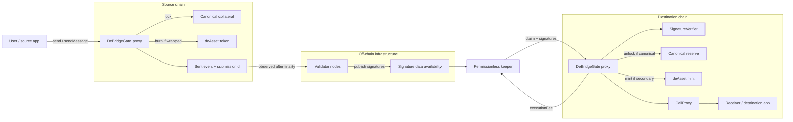

# deBridge EVM Protocol: Architecture, Asset Accounting, Messaging, and Audit Notes

> Code-backed study note for the deBridge contracts in this workspace.  
> Prepared: 2026-08-08 (Africa/Lagos).  
> Local source export: `foundry-v2-debridge-5ce61933e9883e9e`, scope hash `5ce61933e9883e9e`.

## Contents

1. [Scope and version boundary](#1-scope-and-version-boundary)
2. [The protocol in one paragraph](#2-the-protocol-in-one-paragraph)
3. [A useful mental model](#3-a-useful-mental-model)
4. [Actors and components](#4-actors-and-components)
5. [Deployment and proxy map](#5-deployment-and-proxy-map)
6. [Terminology that must not be mixed up](#6-terminology-that-must-not-be-mixed-up)
7. [Core identifiers and signed message](#7-core-identifiers-and-signed-message)
8. [Asset lifecycle and solvency model](#8-asset-lifecycle-and-solvency-model)
9. [Detailed source-chain `send` flow](#9-detailed-source-chain-send-flow)
10. [Fee calculation](#10-fee-calculation)
11. [Message-only `sendMessage` flow](#11-message-only-sendmessage-flow)
12. [Off-chain validation and signatures](#12-off-chain-validation-and-signatures)
13. [Detailed destination-chain `claim` flow](#13-detailed-destination-chain-claim-flow)
14. [Destination execution through CallProxy](#14-destination-execution-through-callproxy)
15. [deAsset deployment and upgrade model](#15-deasset-deployment-and-upgrade-model)
16. [Native-coin wrapping and WethGate](#16-native-coin-wrapping-and-wethgate)
17. [Protocol-fee withdrawal](#17-protocol-fee-withdrawal)
18. [Administrative and upgrade trust](#18-administrative-and-upgrade-trust)
19. [Failure and retry behavior](#19-failure-and-retry-behavior)
20. [Security invariants](#20-security-invariants)
21. [Audit hypotheses and high-value review surfaces](#21-audit-hypotheses-and-high-value-review-surfaces)
22. [Historical v4.1.0 behavior](#22-historical-v410-behavior)
23. [Bug-bounty reading boundary](#23-bug-bounty-reading-boundary)
24. [End-to-end examples](#24-end-to-end-examples)
25. [Audit trace checklist](#25-audit-trace-checklist)
26. [Glossary](#26-glossary)
27. [Source map and references](#27-source-map-and-references)

---

## 1. Scope and version boundary

### What this note explains

This checkout contains the EVM contracts for deBridge's validator-authorized cross-chain messaging and lock/burn/mint asset bridge. In current product language, the closest concepts are the deBridge Messaging Protocol (DMP) and dePort-style canonical asset bridging.

It covers:

- Cross-chain ERC-20 and native-coin transfers.
- Canonical collateral locking and wrapped `deAsset` minting.
- Secondary-chain-to-secondary-chain burn/mint routing.
- Arbitrary destination calldata execution.
- Validator signature verification.
- Permissionless claiming and relayer payment.
- Fee accounting and collection.
- Proxy upgrades, roles, pausing, and submission blocking.

### What it does not explain

This is **not** a description of DLN's intent/order/solver liquidity network. DLN is a separate application built on the broader deBridge stack and uses a zero-TVL liquidity model. The contracts in this checkout are the Gate/validator/deAsset system, not DLN order creation, taker fulfillment, or solver settlement.

### The checkout is a deployed-source export, not a normal repository

The workspace has five chain roots:

- Ethereum (`1`)
- BNB Chain (`56`)
- Polygon (`137`)
- Arbitrum One (`42161`)
- Avalanche C-Chain (`43114`)

There is no project test suite in the export, and the top-level directory is not a Git checkout. The source was collected per deployed address, so the same dependency can appear several times.

### Operational code versus directly listed old implementations

The stable Gate proxy is `0x43dE2d77BF8027e25dBD179B491e8d64f38398aA`. Read-only EIP-1967 checks on all five chains showed that it currently delegates to:

```text
0x797161bcc625155d2302251404ccb93c2632658e
```

That implementation is bundled as `DeBridgeGate_7971` and reports v4.2.1.

The directly listed Gate implementations `0x2445...`, `0xcc75...`, and `0xb1a2...` are byte-identical v4.1.0 sources. They remain relevant for scope/history, but the five stable Gate proxies did **not** point to them at the checked blocks. Therefore:

- Sections describing the reachable proxy path use Gate v4.2.1.
- Historical flash-loan and DeFi-reserve behavior is isolated in [section 22](#22-historical-v410-behavior).
- A source file being in the bounty list is not, by itself, proof that users can reach it through the proxy today.

### Live deAsset implementation gap

The `DeBridgeTokenDeployer` is also a beacon for every deployed deAsset. Its live `tokenImplementation()` was:

```text
0xcacebe8c354b70fa6e3107f3f6f699e4fbb3a98b
```

on all five checked chains. That implementation source is **not included** in this export. The bundled `DeBridgeToken_f8a2`/`DeBridgeToken_c165` source proves the historical storage/interface shape and role-controlled mint/burn model, but it must not be presented as the confirmed live beacon code. The official repository's mutable `main` branch, as reviewed on 2026-08-07, preserved the same core mint/burn/pause roles, with a metadata-initialization difference noted later.

### Evidence labels used below

- **Code guarantee**: directly enforced by the bundled active implementation.
- **Off-chain policy**: performed by validator/keeper infrastructure, not enforced by the EVM contracts.
- **Live configuration**: verified by read-only RPC on 2026-08-07 and able to change later.
- **Audit hypothesis**: a review lead, not a confirmed exploitable or bounty-eligible finding.

---

## 2. The protocol in one paragraph

A user calls `DeBridgeGate` on a source chain. For a canonical asset, the Gate locks the real token; for an already wrapped deAsset, it burns that representation. The Gate calculates fees, constructs a deterministic `submissionId`, and emits a `Sent` event. Validators observe that event off-chain, wait for their chosen source-chain finality, and sign the `submissionId`. Any keeper can collect enough signatures and call `claim` on the destination Gate. The destination reconstructs the same ID, verifies the validator quorum, marks it used, then unlocks canonical collateral or mints the destination deAsset. If calldata was included, the Gate routes the released/minted value through `CallProxy`, which calls the destination application. The keeper can be paid an execution fee committed into the signed message.

The most important security fact is this:

> The destination chain does not verify a source-chain block proof or `Sent` event. It verifies a threshold of validator signatures over a deterministic message hash. The validator quorum, current validator registry, administrative wiring, and proxy upgrade authority are therefore the cross-chain trust root.

---

## 3. A useful mental model

Think of deBridge as a network of warehouses plus a signing committee:

1. The source warehouse locks the original package, or destroys a receipt that represented it.
2. It publishes a tamper-evident manifest (`submissionId`).
3. A committee independently observes the shipment and signs that exact manifest.
4. Any courier can carry the signed manifest to the destination.
5. The destination warehouse checks the committee signatures and either releases the original package or prints a new receipt.
6. If the manifest contains instructions, a guarded dispatcher (`CallProxy`) executes them.

The courier is permissionless. The courier cannot change the receiver, amount, chains, asset, or calldata without invalidating the signatures, but the courier may earn the signed execution fee.



---

## 4. Actors and components

### Human/off-chain actors

| Actor | What it does | What it must be trusted for |
|---|---|---|
| User/source application | Creates an asset transfer or message | Correct receiver, fallback, flags, calldata, and fee choices |
| Validator/oracle | Observes source events and signs valid submissions after finality | Correct source-chain observation, parsing, finality policy, and key security |
| Keeper/claimer/relayer | Delivers parameters and signatures to destination `claim` | Liveness only; signed fields prevent unilateral mutation |
| Governance/admin | Maintains validators, routes, fees, assets, roles, and emergency controls | Correct configuration and honest use of broad powers |
| ProxyAdmin owner | Can replace core implementation code | Full protocol safety; an upgrade can supersede every implementation invariant |
| Fee collector | Withdraws accumulated protocol fees through `SimpleFeeProxy` | Correct custody/accounting after collection |

### On-chain components

| Component | Primary responsibility | Important non-responsibility |
|---|---|---|
| `DeBridgeGate` | Source custody/burn, fees, submission hashing, claim replay state, destination mint/release | Does not independently observe another chain |
| `SignatureVerifier` | Recovers validator signers and enforces current quorum | Does not prove a source event, finality, or validator epoch |
| `OraclesManager` | Stores validator membership and thresholds | Validators do not submit confirmations to it individually |
| `DeBridgeTokenDeployer` | Deploys deterministic beacon-proxy deAssets and serves their implementation | Does not authorize a deployment by itself; Gate first verifies signatures |
| `DeBridgeTokenProxy` | Per-asset beacon proxy | Has no independent implementation admin |
| `DeBridgeToken` | Wrapped representation with role-gated mint/burn/pause | Is not collateral; value depends on canonical reserves and valid claims |
| `CallProxy` | Executes signed destination calldata and handles fallbacks | Does not verify validator signatures itself |
| `WethGate` | Unwraps wrapped native coin and forwards native value | Has no caller authorization |
| `SimpleFeeProxy` | Pulls Gate fees and forwards them to an authorized collector | Does not calculate protocol fees |
| Transparent proxies | Hold durable state and delegate to implementations | Proxy admin is separate from implementation business roles |

---

## 5. Deployment and proxy map

### Stable addresses and implementations

The five networks use the same stable transparent-proxy addresses. Avalanche has different verifier/CallProxy implementation addresses, but their bundled source is byte-identical to the other chains.

| Surface | Stable proxy | Implementation at 2026-08-07 | Version/source boundary |
|---|---|---|---|
| Gate | `0x43dE2d77BF8027e25dBD179B491e8d64f38398aA` | `0x797161bcc625155d2302251404ccb93c2632658e` | v4.2.1; bundled `DeBridgeGate_7971` |
| Token deployer/beacon | `0x8244d6Ffe0695B30b2bAD424683Ee3bc534Ea464` | `0x4c7CA8fcFFE77281A8B81D4580CFf8257d785491` | v1.1.0; bundled |
| Signature verifier | `0x949b3B3c098348b879C9e4F15cecc8046d9C8A8c` | `0xfE7De3c1e1BD252C67667B56347cABFC6df08dF4`; Avalanche `0x2a3e72ed893b5958690e16c3bbe1bd92137b6250` | v2.0.1; sources identical |
| Call proxy | `0x8a0C79F5532f3b2a16AD1E4282A5DAF81928a824` | `0xBd3d657AE87671eC6f8D6272A9f431a7c4a9B6f8`; Avalanche `0xD34c2302F497b8A7fe2d07865f31dBE04d5044d6` | v4.2.3; sources identical |
| Fee proxy | `0xC2bAC0DB5B18B0c3225581Ba14BD0B448c623636` | `0xa1cc7e623423169e1c10e6e5cc8ae6f1d11042de` | v4.1.0; bundled as `SimpleFeeProxy_a1cc` |
| Proxy admin | n/a | `0xE4427af3555CD9303D728C491364FAdFDD7494Fe` | Admin of all five stable proxies |
| WETH helper | direct `0xFCf83648b8cDeF62e5d03319a6f1FCE16e4D6A59` | non-proxy | Set on ETH/BSC/Polygon/Avalanche; unset on Arbitrum |
| All deAssets | one beacon proxy per asset | Beacon returned `0xcacebe8c354b70fa6e3107f3f6f699e4fbb3a98b` | Live implementation absent from this checkout |

### Live configuration snapshot

These values are not constants and should be refreshed before relying on them in a finding, integration, or transaction.

| Chain | RPC block | Gate paused | Global fixed fee | Global fallback transfer fee | Gate high-value excess | Verifier ordinary / congestion excess |
|---|---:|---:|---:|---:|---:|---:|
| Ethereum | 25,706,149 | No | `0.001` native | 10 bps | 3 | 8 / 3 |
| BNB Chain | 114,626,969 | No | `0.005` native | 10 bps | 3 | 8 / 3 |
| Polygon | 91,625,061 | No | `0.5` native | 10 bps | 3 | 8 / 3 |
| Arbitrum | 492,196,193 | No | `0.001` native | 10 bps | 3 | 8 / 3 |
| Avalanche | 92,276,959 | No | `0.05` native | 10 bps | 9 | 8 / 8 |

For the routes among these five checked networks, route-specific fixed/transfer fee values were zero, so the displayed global values were the effective fallbacks. Other routes or later configurations can override them.

Across all five at those blocks:

- 12 validators were active.
- `minConfirmations = 8`.
- `requiredOraclesCount = 0`.
- `confirmationThreshold = 3` successful verifier submissions per destination block. Both claims and `deployNewAsset` use `submit`; congestion logic begins with the fourth successful submission.
- The Gate, verifier, deployer, CallProxy, and FeeProxy wiring was mutually consistent.
- The five ProxyAdmins were owned by Safe contract wallets with a 5-of-8 threshold and the same eight signer addresses.
- The same chain-specific Safe also held `DEFAULT_ADMIN_ROLE` in each of the five core proxies.

The ProxyAdmin/Safe result is a trust-boundary fact, not automatically a bounty issue; the local bounty PDF excludes impacts that are purely centralization or privileged-key assumptions.

---

## 6. Terminology that must not be mixed up

The code uses “native” in two different senses.

| Term | Meaning | Example |
|---|---|---|
| Native coin | The gas currency represented to the Gate by `address(0)` | ETH, BNB, POL/MATIC, AVAX |
| Wrapped native coin | ERC-20 wrapper configured as `weth` | WETH, WBNB, WPOL, WAVAX |
| Canonical/native asset | The original representation on the asset's home chain | Ethereum USDC for an Ethereum-canonical USDC route |
| deAsset/deToken | Minted representation on a non-canonical chain | deUSDC on Polygon |
| Source/origin chain | Chain where `send` or `sendMessage` is called | Ethereum in an ETH-to-Polygon transfer |
| Destination/target chain | Chain where `claim` executes | Polygon in that transfer |
| Submission | The signed cross-chain instruction identified by `submissionId` | Asset, amount, chains, receiver, nonce, optional call |
| Auto parameters | Optional execution fee, flags, fallback, and calldata | “Mint tokens, then call this contract” |
| Keeper/claimer | Anyone who sends the destination `claim` transaction | Receives `executionFee` if one was signed |

When the Gate computes `isNativeToken`, it means “is this asset canonical on the current chain?” It does **not** merely mean “is this the chain's gas coin?”

---

## 7. Core identifiers and signed message

### 7.1 `debridgeId`: global asset identity

An asset is identified by its canonical chain and canonical address bytes:

```text
debridgeId = keccak256(
    abi.encodePacked(canonicalChainId, canonicalTokenAddressBytes)
)
```

Consequences:

- The same logical asset has the same `debridgeId` on every chain.
- A local deAsset address is not used to create a new identity; its `getNativeInfo` record points back to the canonical chain/address.
- A chain's native coin is wrapped first. Its bridge identity uses the configured WETH-like address, not `address(0)`.
- The zero-address form is separately used as the accounting ID for fixed fees collected in raw native coin.

### 7.2 `submissionId`: exact cross-chain instruction

For a regular transfer, v4.2.1 hashes:

```text
submissionId = keccak256(abi.encodePacked(
    uint256(1),             // SUBMISSION_PREFIX
    debridgeId,
    sourceChainId,
    destinationChainId,
    receiverAmount,
    receiverBytes,
    gateGlobalNonce
))
```

For an auto-executed transfer/message, it additionally commits to:

```text
executionFee
flags
keccak256(fallbackAddressBytes)
dataCommitment
keccak256(sourceSenderBytes)
```

where:

```text
dataCommitment = supplied 32-byte hash          if SEND_HASHED_DATA is set
               = keccak256(full calldata)       otherwise
```

The destination reconstructs the same value from `claim` arguments, `_chainIdFrom`, and its own runtime `chainid()`. For `SEND_HASHED_DATA`, an ordinary claimant supplies the full calldata preimage and the destination hashes it. The already-hashed 32-byte commitment is accepted directly only in the special recovery path where `msg.sender == fallbackAddress` and `data.length == 32`.

Every submission binds:

- Asset identity.
- Source and destination chain IDs.
- Receiver amount and receiver.
- Global Gate nonce.

Auto submissions additionally bind:

- Execution reward.
- Failure/gas/unwrap/sender/multicall flags.
- Fallback address.
- Call data or its hash.
- Source sender.

What is **not** bound:

- A Gate contract address.
- A validator-set epoch.
- A source block number/hash.
- A claim deadline or expiry.
- The destination claimer.
- `referralCode`.
- The emitted `FeeParams` values: gross received amount, fixed fee, transfer fee, fee-payment mode, and native/canonical classification.
- The source sender for a regular, non-auto submission.

The chain IDs prevent ordinary cross-destination reuse. Replay on the intended destination is prevented by `isSubmissionUsed[submissionId]`.

### 7.3 Global nonce

`nonce` is one monotonically increasing counter per Gate, not per user or asset. The current value is included in the event/hash, then incremented after publication.

### 7.4 `deployId`: signed deAsset metadata

Before a destination deAsset can be created, validators sign:

```text
deployId = keccak256(abi.encodePacked(
    uint256(2),             // DEPLOY_PREFIX
    debridgeId,
    keccak256(name),
    keccak256(symbol),
    decimals
))
```

The destination chain is not inside `deployId`, allowing the same canonical asset/metadata authorization to be used to create corresponding representations on multiple secondary chains.

### Serialization warning

The source accepts receiver/fallback addresses as arbitrary `bytes`, while the EVM destination `claim` decodes them as `address`. Integrations must use exactly the expected packed address representation. A syntactically valid source submission can become unclaimable if its address bytes cannot reproduce the destination hash.

---

## 8. Asset lifecycle and solvency model

### 8.1 How the Gate classifies an input token

The source Gate reads `getNativeInfo[_tokenAddress]`:

- Empty record: treat the token as canonical to the current chain.
- Recorded canonical chain equals current chain: treat it as canonical here.
- Recorded canonical chain differs: treat it as a deAsset and derive the ID from the stored original chain/address.

For `_tokenAddress == address(0)`, the Gate uses the configured wrapped-native token for asset identity and custody.

### 8.2 First use of a canonical asset

A canonical ERC-20 can be lazily registered on its first outbound send. `_addAsset` records:

- Canonical chain ID.
- Local token address.
- Canonical address bytes.
- `exist = true`.
- Default unlimited `maxAmount`, unless preconfigured.
- `minReservesBps = 10_000` (100%). Active v4.2.1 still writes this storage field for compatibility even though its former DeFi-controller consumer was removed.
- Default high-value threshold of `uint256.max`, unless preconfigured.

The Gate cannot infer that an otherwise unknown ERC-20 is someone else's wrapper: an empty `getNativeInfo` record is treated as canonical to the current chain and can be lazily registered under its own local identity. What cannot be fabricated through this path is a representation mapped back to an existing **foreign** canonical ID; that foreign canonical mapping comes from the signed asset-deployment process.

### 8.3 State transitions by route

| Route | Source action | Destination action | Canonical collateral |
|---|---|---|---|
| Canonical chain -> secondary | Lock real asset; increase native-chain accounting | Mint deAsset; increase secondary accounting | Increases |
| Secondary -> canonical chain | Pull and burn deAsset; decrease secondary accounting | Release real asset; decrease native-chain accounting | Decreases |
| Secondary A -> secondary B | Burn on A; decrease A accounting | Mint on B; increase B accounting | Unchanged |

The important functions are `_send`, `_claim`, and `_mintOrTransfer`.

### 8.4 Solvency invariant

After all messages are settled, the intended economic relationship is:

```text
canonical principal locked on the home chain
    >= aggregate redeemable deAsset supply on secondary chains
```

Ideally the accounting is close to equality, with harmless surplus possible from decimal normalization/dust.

During an in-flight transfer, the system updates the source first:

- Canonical -> secondary: collateral is locked before the destination mint.
- Secondary -> canonical: deAssets are burned before canonical collateral is released.
- Secondary -> secondary: supply is burned before being minted elsewhere.

This ordering makes ordinary pending transfers overcollateralized or supply-reducing, not undercollateralized.

### 8.5 Meaning of `DebridgeInfo.balance`

`getDebridge[debridgeId].balance` is protocol accounting, not a generic `balanceOf` alias:

- On the canonical chain it tracks net bridge principal locked/releasable.
- On a secondary chain it tracks net minted/burned synthetic units.
- Physical canonical token balance can also include unwithdrawn fees and rounding surplus.
- The v4.2.1 active Gate removed the historical reserve-strategy withdrawals, but the old storage fields remain for layout compatibility.

Solvency analysis must compare the accounting record, actual token balances, accumulated/withdrawn fees, deAsset total supplies, and in-flight submissions. Looking at only one value is insufficient.

---

## 9. Detailed source-chain `send` flow

The reachable v4.2.1 `send` is payable, `nonReentrant`, and `whenNotPaused`.

### Step 1: validate the token and optional permit

For an ERC-20, the Gate checks that `decimals()` and `symbol()` calls do not revert.

The v4.2.1 permit envelope is:

```text
permitAmount[32] || deadline[32] || r[32] || s[32] || v[1]
```

It calls the token's EIP-2612-like `permit` so approval and send can occur in one transaction. The embedded `permitAmount` is independent of the bridge `_amount`: a smaller approval makes the later `transferFrom` revert, while a larger one can leave residual allowance. Tokens with incompatible permit semantics must use a prior approval and an empty envelope.

### Step 2: identify canonical versus wrapped representation

The Gate uses `getNativeInfo` as described above and derives the global `debridgeId`.

If this is a canonical asset not seen before, the Gate registers it. If it is classified as wrapped but no asset record exists, it reverts with `DebridgeNotFound`.

### Step 3: check destination support

`getChainToConfig[_chainIdTo].isSupported` must be true. Outgoing and incoming support are independent; the destination must separately accept this source through `getChainFromConfig`.

### Step 4: receive or wrap the asset

For an ERC-20:

```text
balanceBefore = token.balanceOf(Gate)
token.safeTransferFrom(user, Gate, requestedAmount)
receivedAmount = token.balanceOf(Gate) - balanceBefore
```

The fee and maximum-transfer checks use `receivedAmount`, not blindly the requested amount.

For the chain's native coin:

- `_tokenAddress` is zero.
- The `_amount` argument is replaced by `msg.value`.
- The entire `msg.value` is deposited into configured WETH-like custody.
- Asset-fee mode is forced, so the fixed fee is deducted from the wrapped amount.

The local bounty rules expressly say default bridging does not support non-standard rebasing, elastic-supply, or fee-on-transfer assets. The measured-balance pattern is defensive, but it must not be read as a promise that every non-standard token is supported end to end.

### Step 5: enforce the asset maximum

The actual received amount must not exceed `debridge.maxAmount`. Admin can preconfigure this value even before the first asset registration.

### Step 6: calculate protocol fees

The calculation is detailed in [section 10](#10-fee-calculation).

### Step 7: lock or burn the post-protocol-fee principal

Let `P` be the amount after fixed and percentage protocol fees, but before execution-fee subtraction and decimal rounding.

- Canonical asset: `debridge.balance += P`; the token remains in Gate custody.
- Wrapped deAsset: `debridge.balance -= P`; the Gate burns `P` from its own token balance.

For a wrapped send, the Gate first pulled the user's deAssets into itself, so the token's `burn` removes the Gate's balance.

### Step 8: reserve the keeper execution fee

If auto parameters exist, `executionFee` is normalized to at most eight decimal places. If the supplied fee exceeds `P`, v4.2.1 clamps it to `normalize_to_8_decimals(P)`, not to the unrounded `P`.

```text
receiverAmountBeforeRounding = P - executionFee
```

### Step 9: normalize the receiver amount

For assets with more than eight decimals:

```text
unit = 10 ** (tokenDecimals - 8)
receiverAmount = floor(receiverAmountBeforeRounding / unit) * unit
```

Assets with eight or fewer decimals are unchanged.

The source accounting/burn already used `P`, while the signed destination movement is `receiverAmount + executionFee`. The difference is nonnegative dust that remains as extra canonical collateral or permanently reduced synthetic supply.

### Step 10: publish the submission

The Gate calculates `submissionId`, emits `Sent` and monitoring events, then increments the global nonce. No destination transaction is created by the EVM contract at this stage.

---

## 10. Fee calculation

### 10.1 Variables

Let:

- `R` = actual amount received by the Gate.
- `F` = fixed fee deducted from the bridged asset, or zero if paid separately in native coin.
- `b` = selected nominal percentage transfer fee in basis points.
- `d_t` = caller's percentage-fee discount in basis points.
- `T_0` = nominal percentage fee before discount.
- `T` = percentage fee after discount.
- `P` = post-protocol-fee principal.
- `E` = execution fee paid to the destination claimer.
- `A` = receiver amount after eight-decimal normalization.

Then:

```text
T_0 = floor(b * (R - F) / 10_000)
T = T_0 - floor(T_0 * d_t / 10_000)
P = R - F - T
A = normalize_to_8_decimals(P - E)
destination total mint/release = A + E
```

### 10.2 Paying the fixed fee separately in native coin

For an ERC-20 with `_useAssetFee == false`:

1. Use destination-specific `fixedNativeFee`, or `globalFixedNativeFee` if the destination value is zero.
2. Apply the caller's fixed-fee discount.
3. Require at least that much `msg.value`.
4. Refund excess native coin.
5. Credit this raw-native fee under `keccak256(currentChainId, address(0))`.
6. Set `F = 0` for the bridged ERC-20.

### 10.3 Paying the fixed fee in the bridged asset

For `_useAssetFee == true`:

- Native coin: use destination fixed-native fee, falling back to the global value, but deduct it from wrapped `msg.value`.
- ERC-20: use the per-asset/per-destination `getChainFee` value. A zero value reverts as unsupported rather than meaning free.
- Apply the caller's fixed-fee discount.
- Set `F` to that discounted amount.

Native-coin sends always enter this mode.

For an ERC-20 in asset-fee mode, callers should set `msg.value = 0`. The code's refund and raw-native fee accounting exist only in the `_useAssetFee == false` branch; native value accidentally attached to an ERC-20 asset-fee send is neither refunded nor entered in the fee ledger and can remain stranded in the Gate.

### 10.4 Percentage fee

The destination's `transferFeeBps` is used unless it is zero, in which case `globalTransferFeeBps` is used. Therefore a zero route value is a fallback marker, not necessarily a free-transfer setting.

The percentage fee is computed on `R - F`, then reduced by the caller's percentage-fee discount.

### 10.5 Discounts

Fixed and percentage discounts are independent:

```text
discountedFee = nominalFee - floor(nominalFee * discountBps / 10_000)
```

This subtraction order matters: it can differ by one smallest unit from multiplying by `(10_000 - discountBps)` and then dividing. The transfer fee is first integer-rounded from the selected route/global BPS and only then discounted.

They are keyed by `msg.sender`, so an integrating router's discount does not automatically follow the router's end user.

### 10.6 Fee ledgers

Asset-denominated fixed fees and transfer fees accumulate in:

```text
getDebridgeFeeInfo[debridgeId].collectedFees
```

Raw native fixed fees accumulate under the special zero-address ID. `withdrawnFees` is cumulative and prevents the same recorded fee from being withdrawn twice.

### 10.7 Numerical example

Assume an ERC-20 transfer where:

```text
R = 100.000 tokens
fixed fee is paid separately in native coin, so F = 0
b = 10 bps = 0.1%
d_t = 0 (no percentage-fee discount)
E = 0.200 tokens
```

Then:

```text
T_0 = 10 * 100 / 10_000 = 0.100
T = T_0 because d_t = 0
P = 100.000 - 0 - 0.100 = 99.900
A = 99.900 - 0.200 = 99.700  (assuming no decimal dust)
```

- Protocol records `0.100` token fee.
- Source locks or burns `99.900`.
- Destination pays `0.200` to the claimer.
- Destination transfers/mints `99.700` for the receiver or CallProxy.
- Total destination movement is `99.900`.

---

## 11. Message-only `sendMessage` flow

Gate v4.2.1 adds two `sendMessage` overloads for arbitrary cross-chain calls without receiver principal.

The simple overload sets these flags automatically:

```text
REVERT_IF_EXTERNAL_FAIL = true
PROXY_WITH_SENDER       = true
```

The detailed flow is:

1. Require nonempty target-address bytes and target calldata.
2. Internally process the source native coin through `_send`.
3. Deduct the fixed and percentage protocol fees from `msg.value`.
4. Set the signed receiver principal to zero.
5. Put the remaining value, normalized down to at most eight decimals, into `executionFee`.
6. Bind the source caller as `nativeSender`.
7. Use `_targetContractAddress` as both the base receiver bytes and the auto fallback address, then publish the auto submission containing the target and calldata.

Conceptually:

```text
msg.value
    -> protocol fixed/percentage fees
    -> normalized remainder becomes the keeper's cross-chain execution reward
    -> any normalization dust remains source-side

signed target principal = 0
```

The destination target call therefore receives no bridged principal from `sendMessage` itself. The keeper receives the execution fee as the destination representation of the source native asset, while `CallProxy` executes the signed calldata with zero asset amount/value. If an application needs value as well as a call, it should use the full asset `send` with auto parameters or design the destination operation accordingly.

Because the default overload sets `REVERT_IF_EXTERNAL_FAIL`, a target revert makes the entire claim retryable rather than consuming the message.

---

## 12. Off-chain validation and signatures

### 12.1 What validator nodes do

According to the official protocol description, validator nodes:

1. Monitor `Sent` events from supported source Gates.
2. Wait for the configured/source-specific finality policy.
3. Validate the event fields and submission structure.
4. Sign the `submissionId` with their validator key.
5. Publish signatures to off-chain data availability (the documentation describes Arweave).

This finality process is an **off-chain policy**. Neither `DeBridgeGate` nor `SignatureVerifier` verifies a source block header, Merkle proof, receipt, or confirmation count.

Official lifecycle documentation has described 12 confirmations for most supported EVM networks and 256 for Polygon. Such operational values can change and must not be treated as Solidity constants.

### 12.2 Signed digest and byte format

Each validator signs the EIP-191/personal-sign digest:

```text
keccak256("\x19Ethereum Signed Message:\n32" || submissionId)
```

The claimer supplies a tightly concatenated byte array:

```text
r[32] || s[32] || v[1] || r[32] || s[32] || v[1] || ...
```

Rules enforced by `SignatureVerifier`:

- Total byte length must be divisible by 65; otherwise it counts as zero signatures.
- `v = 0/1` is normalized to `27/28`.
- Other `v` values except `27/28` revert.
- Signers are recovered with `ecrecover`; the caller does not supply a trusted signer list.
- Signatures from invalid/unregistered recovered addresses are ignored.
- A duplicated valid signer reverts.
- Signatures need not be address-sorted.
- The loop stops once the current required quorum and every required oracle have been seen; trailing signatures are ignored.

The code does not enforce low-`s`, but signature malleability cannot create two votes from one validator because both forms recover the same address and duplicate detection prevents double counting.

### 12.3 Validator/oracle registry

The code calls validator signing keys “oracles.” Each `OracleInfo` has:

- `exist`: historically registered.
- `isValid`: currently active and countable.
- `required`: must appear in every successful quorum.

Required validators count inside the ordinary threshold; they are not additional signatures on top. If one is configured, its downtime becomes a claim-liveness veto.

Disabling a validator removes it from the active-address array but leaves `exist = true`, so it is later reactivated through `updateOracle` rather than re-added.

### 12.4 Ordinary quorum

Let:

```text
M = SignatureVerifier.minConfirmations
H = Gate.excessConfirmations if receiverAmount >= assetThreshold, else 0
```

The initial required count is:

```text
needConfirmations = max(M, H)
```

A claim also needs every currently required oracle.

At the checked blocks, all five networks had 12 active validators and `M = 8`, with no required oracle.

### 12.5 High-value quorum

Each asset has `getAmountThreshold[debridgeId]`. The Gate passes its `excessConfirmations` override when:

```text
signed receiverAmount >= assetThreshold
```

Newly auto-registered assets default their threshold to `uint256.max`, so the admin must lower it for this tier to activate.

Live effect at the checked blocks:

- Ethereum, BNB Chain, Polygon, and Arbitrum Gate excess was `3`, below the ordinary `8`; it added no signatures.
- Avalanche Gate excess was `9`; a threshold-triggering claim required nine signatures.

### 12.6 Per-destination-block congestion quorum

The verifier also counts approved submissions in the current destination block. After more than `confirmationThreshold` approvals in the same block, it requires its own stored `excessConfirmations`.

This is often misunderstood:

- `confirmationThreshold` is a count of successful verifier `submit` calls in one destination block. Both claims and signed asset deployments contribute.
- It is not the number of validator signatures.
- It is not source-chain finality.

At the checked blocks, `confirmationThreshold = 3` everywhere, but verifier excess was never greater than the ordinary quorum, so it did not strengthen live verification.

There is an ordering edge: the signature loop breaks at the initial quorum before the later congestion check. If a future configuration sets congestion excess above the initial quorum while no required oracle delays the break, later signatures cannot be counted and post-threshold verifier submissions can become impossible. This is an audit/configuration concern, not a present live effect under the checked values.

### 12.7 Registry time and pending messages

There is no validator epoch inside `submissionId`. Membership is evaluated when `claim` executes:

- Removing a signer can invalidate an old unclaimed signature bundle.
- Adding a signer allows that new signer to sign an old unexpired submission ID.
- Changing the quorum changes what pending submissions need.

There is also no claim expiry. A valid, unused, unblocked submission can remain claimable subject to the current registry/configuration and available collateral.

### 12.8 Only the Gate can invoke quorum verification

`SignatureVerifier.submit` accepts calls only from its configured `debridgeAddress`. A random account cannot ask the verifier to approve a message directly. Correct mutual wiring is essential:

```text
Gate.signatureVerifier == verifier proxy
Verifier.debridgeAddress == Gate proxy
```

---

## 13. Detailed destination-chain `claim` flow

Anyone can call `claim`; there is no privileged relayer allowlist.

### Step 1: check accepted source chain

`getChainFromConfig[_chainIdFrom].isSupported` must be true. This is independent of the source Gate's outgoing setting.

### Step 2: decode optional auto parameters

Destination auto parameters are:

```text
executionFee
flags
fallbackAddress       // EVM address
data
nativeSender          // arbitrary bytes for cross-VM compatibility
```

They must reproduce the source commitment exactly.

### Step 3: reconstruct `submissionId`

The destination uses:

- Supplied `debridgeId`.
- Supplied source chain.
- Its own runtime chain ID as destination.
- Supplied amount, receiver, and source nonce.
- Supplied auto parameters.

A changed amount, receiver, source, nonce, fallback, execution fee, flags, calldata, or native sender produces a different ID and invalid signatures.

### Step 4: mark replay state before external interactions

The Gate rejects `isSubmissionUsed[submissionId]`, then immediately writes it `true` before signature verification and token/call interactions.

This is safe against invalid attempts permanently consuming a message because EVM reverts are atomic. If verification, mint/release, target execution, or fallback transfer later reverts, the `true` write is rolled back.

It also provides message-specific reentrancy protection: the same submission cannot be successfully entered twice inside one transaction. `claim` itself has no `nonReentrant` modifier, so verifier, token, receiver, or CallProxy interactions can reenter a **different** unused submission. That is a separate cross-submission surface and must not be confused with same-ID replay protection.

### Step 5: blocklist and signature verification

An admin-blocked submission reverts before verifier submission. Otherwise the Gate selects the ordinary/high-value threshold and asks the configured `SignatureVerifier` to validate the concatenated signatures.

### Step 6: update asset accounting

The destination determines whether this is the asset's canonical chain:

- Canonical here: decrease locked-principal accounting by `amount + executionFee`.
- Secondary here: increase synthetic accounting by `amount + executionFee`.

Solidity checked arithmetic prevents a canonical release above recorded accounting. The actual ERC-20/WETH transfer must also succeed.

### Step 7: pay the claimer

If `executionFee > 0`, the Gate transfers or mints that amount to `msg.sender`, the permissionless claimer.

The claimant is paid before the destination application call, but a later revert rolls the payment back with the rest of the claim.

### Step 8: direct delivery or auto execution

- No calldata: transfer/mint receiver amount directly to `receiver`.
- Calldata: transfer/mint receiver amount to `CallProxy`, then ask it to execute the signed operation.
- Canonical WETH with `UNWRAP_ETH`: unwrap receiver principal and use CallProxy's native-value path, or send native coin directly when no calldata exists.

The execution fee is not part of the unwrap branch; it remains the token representation paid to the claimer.

### Step 9: emit result events

The Gate emits `Claimed`, and for auto execution also `AutoRequestExecuted`. Monitoring events expose the Gate accounting balance and local token total supply.

---

## 14. Destination execution through CallProxy

`CallProxy` isolates arbitrary user-specified calls from the Gate. It does not verify signatures; it trusts only addresses holding `DEBRIDGE_GATE_ROLE`.

Both `call` and `callERC20` have a shared lock, preventing nested `CallProxy.call`/`callERC20` execution while temporary source context is stored. The lock does not make `Gate.claim` globally non-reentrant.

### 14.1 Native-value path

The Gate unwraps canonical WETH directly to CallProxy, then calls:

```text
CallProxy.call(
    fallbackAddress,
    receiver,
    data,
    flags,
    nativeSender,
    chainIdFrom
)
```

CallProxy:

1. Reads its **entire native balance**.
2. Calls `receiver` with that value and the signed calldata.
3. Reverts the whole claim if the call failed and `REVERT_IF_EXTERNAL_FAIL` is set.
4. Otherwise forwards CallProxy's balance after the receiver call to `fallbackAddress`.

The receiver is called with the **entire** native balance at call entry; there is no unsent portion held back. After a successful call, only native value returned or otherwise sent back to CallProxy during execution can remain for fallback. After a failed tolerant call, the attempted value transfer is reverted inside the low-level call, so that balance remains available for fallback.

### 14.2 ERC-20 path

The Gate transfers canonical tokens or mints deAssets to CallProxy, then calls `callERC20`.

CallProxy:

1. Reads its **entire balance** of that token.
2. Approves `receiver` for the whole balance.
3. Calls `receiver` with zero native value.
4. Expects the receiver to pull what it needs using `transferFrom(CallProxy, ...)`.
5. Applies the selected revert/tolerate failure policy.
6. Sends every residual token to `fallbackAddress`.
7. Resets the receiver's allowance to zero.

The receiver is not automatically pushed ERC-20 tokens. An integration that expects tokens in its balance before entering the call will be wrong; the balance is in CallProxy and the receiver has allowance.

Low-level success only means the call did not revert. Return data or a returned boolean is not interpreted.

### 14.3 Failure flag

| Receiver outcome | `REVERT_IF_EXTERNAL_FAIL` | Result |
|---|---:|---|
| Success | either | Claim succeeds; residual funds go to fallback |
| Revert/OOG | true | Entire claim reverts; submission remains unused and retryable |
| Revert/OOG | false | Claim succeeds; funds are routed to fallback |

Even in tolerant mode, a failing transfer to the fallback makes the transaction revert.

### 14.4 Source-sender context

With `PROXY_WITH_SENDER`, CallProxy temporarily stores:

```text
submissionChainIdFrom
submissionNativeSender
```

The receiver reads those getters during the external call. They are cleared immediately afterwards.

A safe receiver should authenticate all three facts:

```text
msg.sender == trusted CallProxy
CallProxy.submissionChainIdFrom() == trusted source chain
CallProxy.submissionNativeSender() == trusted packed source sender
```

Checking only `msg.sender == CallProxy` proves that some authorized Gate submission triggered the call; it does not prove which source application sent it.

This is context exposure, not EVM sender forwarding. The receiver still sees `msg.sender == CallProxy`.

### 14.5 Explicit external-call gas

With `SEND_EXTERNAL_CALL_GAS_LIMIT` **and `data.length > 4`**, CallProxy reads the first four bytes as a big-endian `uint32` gas limit, strips them, and calls the destination with that limit. With four or fewer bytes, the prefix branch is skipped: nothing is stripped and the normal remaining-gas path is used.

The `Flags` comment says “first 24 bytes,” but the implementation consumes four. The code also checks EIP-150 headroom plus cleanup gas before performing the call.

If the claim transaction itself does not supply enough gas, this mode reverts before the destination call. The local bounty PDF explicitly excludes insufficient claimer gas that merely causes external-call failure.

### 14.6 MultiSend

With `MULTI_SEND`, CallProxy changes the destination to itself. The signed outer calldata must invoke `multiSend(bytes)`. Each inner packed entry is:

```text
operation[1] || target[20] || value[32] || dataLength[32] || data[dataLength]
```

Only `operation == 0` (`CALL`) is permitted. Delegatecall is rejected, protecting CallProxy's storage/context. Any failed inner call reverts the self-called batch. That self-call then reports failure to the outer CallProxy logic: the whole bridge claim reverts only if `REVERT_IF_EXTERNAL_FAIL` is set; in tolerant mode the claim can complete and route the remaining asset to fallback.

`multiSend` is externally callable only by CallProxy itself, so it can be reached through this self-call route but not directly by arbitrary users.

### 14.7 Balance-sweeping assumption

The native and ERC-20 paths use CallProxy's entire matching balance, not a passed amount. Correct operation assumes CallProxy is balance-less between claims. Donated or stranded funds can be swept into the next matching signed execution.

This is a concrete review surface whenever an analysis assumes “the call can use only this claim's amount.”

### 14.8 Destination receiver integration checklist

- Trust the exact current CallProxy address.
- Verify source chain and packed source sender during the call.
- Pull ERC-20s with `transferFrom`, rather than assuming they were pre-transferred.
- Decide whether partial consumption is intended.
- Choose a fallback that can receive the asset/native coin.
- Choose failure semantics deliberately.
- Encode the four-byte gas prefix correctly when used.
- Treat CallProxy context getters as valid only during the call.
- Never use `tx.origin` as cross-chain authentication.

---

## 15. deAsset deployment and upgrade model

### 15.1 Signed creation flow

When a canonical asset needs its first representation on a secondary chain:

1. Validators sign the `deployId` binding canonical asset ID and metadata.
2. Anyone can call `Gate.deployNewAsset` with that metadata and enough signatures.
3. Gate verifies the deploy signatures with its configured excess value.
4. Gate asks `DeBridgeTokenDeployer.deployAsset` to create the token.
5. Deployer creates one `DeBridgeTokenProxy` with CREATE2 using `debridgeId` as salt.
6. Gate registers the new local token/canonical mapping.

The deployment is permissionless after authorization; only the configured Gate can invoke the deployer.

### 15.2 Initialization and roles

The Deployer supplies initialization data containing:

- `deBridgeTokenAdmin` as the `admin` argument.
- The configured Gate as the one-element initial `minters` array.
- Name, symbol, and decimals, subject to Deployer-admin metadata overrides.

The selected beacon implementation decides what those arguments mean. The bundled known token implementation grants default-admin and pauser roles to `admin`, and minter role to the Gate. Under the intended configuration, effective mint/burn authority must remain confined to trusted Gate logic for collateralization to hold.

### 15.3 Beacon structure

Each deAsset is a `BeaconProxy` whose beacon is the **TokenDeployer proxy**. On every call, the token proxy asks the deployer:

```text
implementation() -> tokenImplementation
```

Therefore one Deployer-admin action can change the implementation of every existing deAsset on that chain.

Consequences:

- `setTokenImplementation` is a global deAsset upgrade switch.
- The setter checks nonzero but does not require the address to contain code.
- `setDeBridgeTokenAdmin` affects future initializations; it does not rewrite roles in existing token proxy storage.
- `setDebridgeAddress` changes who deploys and which Gate becomes minter for future tokens; it does not automatically revoke roles in already-deployed tokens.

### 15.4 Token behavior evidenced by bundled and repository-main source

The bundled historical token and the official repository's `main` source reviewed on 2026-08-07 implement the same important control shape:

- ERC-20 balances/allowances.
- Custom decimals.
- `MINTER_ROLE` for `mint(receiver, amount)` and `burn(amount)`.
- Burn removes the caller's balance, which is why Gate first pulls user deAssets into itself.
- `PAUSER_ROLE`, with pausing applied to transfers, minting, and burning.
- EIP-712 permit support.

The bundled older implementation automatically prefixes display names/symbols with `deBridge ` / `de`; the reviewed repository-main source did not. More importantly, `main` is mutable and the live beacon target is outside this checkout, so exact deployed token logic must be fetched and matched to deployed bytecode before a token-specific conclusion.

---

## 16. Native-coin wrapping and WethGate

### Source-chain wrapping

For `tokenAddress == address(0)`, Gate wraps the full `msg.value` into its configured WETH-like token. The bridge then uses ERC-20 accounting internally.

### Destination unwrapping

`UNWRAP_ETH` applies only when:

- The asset is canonical on the destination chain.
- Its local token is the configured WETH-like token.

A deAsset representation of another chain's native coin is not locally canonical and is therefore not unwrapped by this branch.

### WethGate helper

Where configured, Gate:

1. Transfers WETH to `WethGate`.
2. Calls `WethGate.withdraw(receiver, amount)`.
3. WethGate unwraps and forwards native coin with a full-gas `.call`.

The helper exists to avoid constrained-stipend problems when classic wrapped-native contracts send value back to upgradeable proxies.

`WethGate.withdraw` has no caller restriction. Its safety relies on the atomic Gate pattern: transfer exactly the needed WETH, then immediately withdraw it. Any WETH accidentally left there can be permissionlessly sent to an arbitrary receiver.

Arbitrum's checked Gate had `wethGate == address(0)`, so it used Gate's direct unwrap-and-forward branch.

---

## 17. Protocol-fee withdrawal

### Gate ledger

Only the configured FeeProxy can call `Gate.withdrawFee(debridgeId)`.

```text
withdrawable = collectedFees - withdrawnFees
```

The Gate first increments `withdrawnFees`, then transfers:

- Raw native coin for the zero-address fee ID.
- The registered local token for any asset ID.

If transfer fails, the transaction reverts and the ledger update rolls back.

### Live SimpleFeeProxy v4.1

The live FeeProxy requires `FEE_COLLECTOR_ROLE` and an unpaused state. It can batch token addresses:

- Zero address: pull raw-native fees, then send FeeProxy's entire native balance to the collector caller.
- ERC-20/deAsset: derive its canonical `debridgeId`, pull Gate fees, then send FeeProxy's entire token balance to the collector caller.

The old treasury storage slot remains deprecated for storage compatibility. Unlike the older v4.0 design, the live v4.1 proxy pays the authorized collector caller rather than an always-fixed treasury.

Like CallProxy, FeeProxy sweeps pre-existing donations/stranded balances of the selected asset.

---

## 18. Administrative and upgrade trust

There are two separate authority planes.

### 18.1 Upgrade authority

Every stable core address is an OpenZeppelin transparent proxy. The common ProxyAdmin can:

- Upgrade an implementation.
- Upgrade and execute migration calldata.
- Change proxy admin.

Its owner can therefore replace logic that controls all reserves and message verification. No implementation-level role or validator quorum constrains a ProxyAdmin upgrade.

At the checked blocks, chain-specific 5-of-8 Safe wallets owned ProxyAdmin.

### 18.2 Business/configuration authority

| Contract/role | Powers |
|---|---|
| Gate `DEFAULT_ADMIN_ROLE` | Chain directions/fees, asset caps/reserve fields/thresholds, verifier, CallProxy, TokenDeployer, FeeProxy, WethGate, fee updater, discounts, blocking, unpause |
| Gate `GOVMONITORING_ROLE` | Pause sends/claims/deployments |
| Gate `feeProxy` address | Pull recorded fees only |
| Gate `feeContractUpdater` address | Update global fixed native fee only; it was zero on all five checked chains |
| Verifier `DEFAULT_ADMIN_ROLE` | Add/disable/reactivate validators, required flags, ordinary/excess thresholds, congestion threshold, authorized Gate |
| CallProxy `DEFAULT_ADMIN_ROLE` | Grant/revoke `DEBRIDGE_GATE_ROLE` |
| CallProxy `DEBRIDGE_GATE_ROLE` | Supply arbitrary destination calls, values, origin metadata, and flags to CallProxy |
| TokenDeployer `DEFAULT_ADMIN_ROLE` | Global token implementation, future token admin, authorized Gate, metadata overrides |
| deAsset `DEFAULT_ADMIN_ROLE` | Role administration inside that individual token proxy |
| deAsset `MINTER_ROLE` | Mint and burn; intended for Gate |
| deAsset `PAUSER_ROLE` | Pause/unpause transfers, mint, and burn |
| FeeProxy `DEFAULT_ADMIN_ROLE` | Change Gate, pause/unpause, manage collector role |
| FeeProxy `FEE_COLLECTOR_ROLE` | Pull and receive accumulated fees |
| WethGate | No access control on unwrap |

At the checked blocks, the same chain-specific Safe that owned ProxyAdmin also held `DEFAULT_ADMIN_ROLE` across Gate, verifier, TokenDeployer, CallProxy, and FeeProxy. This concentrates upgrade and operational governance in the same 5-of-8 control group.

### 18.3 Wiring invariants

Correct operation requires all of the following simultaneously:

```text
Gate.signatureVerifier == Verifier proxy
Verifier.debridgeAddress == Gate proxy

Gate.callProxy == CallProxy proxy
CallProxy.hasRole(DEBRIDGE_GATE_ROLE, Gate proxy) == true

Gate.deBridgeTokenDeployer == TokenDeployer proxy
TokenDeployer.debridgeAddress == Gate proxy

Gate.feeProxy == FeeProxy proxy
FeeProxy.debridgeGate == Gate proxy

Gate.weth and optional WethGate.weth refer to the intended wrapped native token
```

A role name or source comment is not proof of this deployment state; it must be checked on-chain.

---

## 19. Failure and retry behavior

| Condition | Where it fails | Is submission consumed? | Typical resolution |
|---|---|---:|---|
| Destination route does not accept source chain | Start of `claim` | No | Governance enables route or transfer remains stuck |
| Submission already claimed | Replay check | Already yes | None; intended one-time delivery |
| Submission administratively blocked | Before signature verification | No | Admin unblocks it |
| Too few/currently invalid signatures | Verifier | No | Collect a valid current quorum |
| Required validator missing | Verifier | No | Obtain its signature or governance changes registry |
| Unknown destination asset | `_claim` | No | Perform signed deAsset deployment first |
| Canonical accounting/reserve insufficient | `_claim`/token transfer | No | Restore reserves/correct accounting; retry later |
| Destination call fails, revert flag set | CallProxy | No | Retry after destination state changes or with more gas; signed calldata is immutable except that a valid preimage can be supplied for `SEND_HASHED_DATA` |
| Destination call fails, revert flag clear | CallProxy | Yes, if fallback succeeds | Funds go to fallback; external action is skipped |
| Fallback rejects native/token transfer | CallProxy | No | Make the signed fallback capable of receiving, if possible; it cannot be replaced, so the submission may remain unclaimable |
| Explicit call gas exceeds transaction headroom | CallProxy precheck | No | Submit claim with more gas |
| Gate paused | `send`, `claim`, or deployment | No | Gate admin unpauses |
| deAsset paused | Mint/burn/transfer | No | Token pauser unpauses |
| Validator data unavailable/no keeper incentive | Off-chain liveness | No | Recover signatures or submit claim manually |

### Wrong receiver/fallback/data can be permanent

The receiver, fallback, flags, and data commitment are signed into the submission. They cannot simply be corrected at claim time.

The local bounty rules expressly exclude a user's own incorrect receiver/fallback and a deliberately irrecoverable `REVERT_IF_EXTERNAL_FAIL` configuration. Those are nevertheless important integration hazards.

### `SEND_HASHED_DATA` recovery path

Normally this flag allows the source to commit only a 32-byte calldata hash, while a later claimant supplies the full preimage.

There is a special destination reconstruction rule: if the claimant is the signed fallback address and supplies exactly 32 bytes, those bytes can be treated as the already-hashed commitment. This permits reconstruction of the submission ID when the original calldata preimage is lost; it does **not** guarantee that the fallback receives the funds.

The 32-byte hash is still executed as `data` against the signed receiver. In tolerant mode, assets remaining in CallProxy can go to fallback. But a successful native receiver call receives the entire native balance, and a successful ERC-20 receiver can pull tokens under its allowance. With `REVERT_IF_EXTERNAL_FAIL`, a receiver failure still reverts the recovery attempt.

---

## 20. Security invariants

These are the properties an audit or integration should continuously test.

### 20.1 Message authenticity

Destination effects require a reconstructed `submissionId` authorized by the current validator quorum:

```text
claimed fields -> reconstructed submissionId -> current validator quorum
```

Whether that ID was actually produced by a source Gate is an off-chain quorum assertion, not an on-chain proof. Regular submissions bind asset, chains, amount, receiver, and nonce. Execution fee, flags, fallback, calldata commitment, and source sender are bound only for auto submissions. The destination claimer is not signed.

### 20.2 One-time execution

For each destination Gate:

```text
successful claims per submissionId <= 1
```

The `isSubmissionUsed` write must precede mint/release/external calls and revert atomically on failure.

### 20.3 Collateralization

For each canonical asset, after accounting for in-flight burns/locks and fees:

```text
redeemable deAsset liabilities <= accessible canonical collateral
```

Under the intended role configuration, only the Gate should hold effective deAsset mint authority. `mint` is role-gated, not intrinsically claim-gated, and token role admins or a beacon implementation upgrade can change that authority. No unprivileged path should release canonical value without decreasing the corresponding accounting.

### 20.4 Canonical asset identity

Every local representation must resolve to one unambiguous canonical `(chainId, addressBytes)` pair. A local deAsset address must never be mistaken for a newly canonical asset.

### 20.5 Fee conservation

For a send:

```text
received = protocol fees + source principal
source principal >= signed receiver amount + signed execution fee
```

The remaining difference should be explainable decimal dust.

For withdrawal:

```text
cumulative withdrawnFees <= cumulative collectedFees
```

### 20.6 Destination call isolation

- Only trusted Gate-role addresses enter CallProxy.
- No delegatecall occurs in MultiSend.
- Temporary source context is cleared.
- Receiver allowance is reset.
- Failure/fallback behavior matches signed flags.

### 20.7 Configuration consistency

Proxy target, business-role holders, validator membership, route directions, Gate/verifier mutual references, Gate/CallProxy roles, beacon implementation, WETH helpers, asset thresholds, and fee schedules must be treated as part of the live protocol—not as optional deployment trivia.

---

## 21. Audit hypotheses and high-value review surfaces

> These are review leads, not confirmed vulnerabilities. A bounty report still needs live reachability, attacker privilege, a broken invariant, reproducible impact, and deduplication/known-issue analysis.

### 21.1 High-value threshold compares only receiver amount — investigated; not High/Critical

This was the strongest remaining lead because the Gate's high-value quorum check and its actual reserve outflow use different quantities.

#### The mismatch is real in code

On the source chain, `send` normalizes and caps `autoParams.executionFee`, subtracts it from the post-protocol-fee amount, and publishes the remainder as the signed receiver `_amount` ([active Gate source](./foundry-v2-debridge-5ce61933e9883e9e/chains/ethereum-1/src/DeBridgeGate_7971/contracts/transfers/DeBridgeGate.sol)). On the destination:

- `claim` calls `_checkConfirmations(..., _amount, ...)`.
- `_checkConfirmations` selects `excessConfirmations` only when `_amount >= getAmountThreshold[_debridgeId]`.
- `_claim` debits `debridge.balance` by `_amount + _autoParams.executionFee` and pays the execution fee to the permissionless claimer.

Therefore, for a hypothetical finite threshold `T`, a signed transfer with receiver amount just below `T` and execution fee `9T` would be checked as a low-value transfer while moving approximately `10T` from the reserve. The execution fee is included in the signed submission hash, so this is a quorum-classification mismatch, not a signature-forgery or field-malleability bug.

#### Live state and reachability

The mismatch does not currently produce an exploitable high-value path in the checked deployment:

- Avalanche currently reports Gate `excessConfirmations = 9`, verifier `minConfirmations = 8`, and no required-oracle subset. Ethereum reports Gate `excessConfirmations = 3` with the same ordinary quorum of `8`; the other checked-chain snapshot is recorded in [section 5](#5-deployment-and-proxy-map).
- Read-only `getAmountThreshold` calls at the 2026-08-08 latest state returned `2^256 - 1` for every one of the 114 current Avalanche `PairAdded` asset IDs and all 308 current Ethereum IDs queried. Since ordinary transfer amounts are bounded far below that value, no current asset reaches the Gate's per-asset high-value branch. The configured Avalanche 9-of-12 protection is therefore dormant for the live asset set.

#### Severity and attacker test

Even if governance later sets a finite Avalanche threshold, the mismatch alone does not let an ordinary attacker steal funds:

1. Honest validators sign the exact `executionFee` and receiver amount chosen in the source transaction; a claimer cannot change either without invalidating the submission ID.
2. The user who chooses a very large execution fee is voluntarily assigning that value to the permissionless claimer. There is no victim transfer or unauthorized mint in that path.
3. To turn the one-signature quorum difference into theft, an attacker would still need enough validator keys to fabricate a signed submission (eight validators under the observed ordinary quorum). The local program scope excludes impacts requiring leaked keys/credentials or privileged-address access ([scope PDF](<./deBridge Bug Bounties _ Immunefi(scope).pdf>)).

**Disposition: confirmed semantic mismatch, but not a submission-worthy High/Critical finding.** At most it is a defense-in-depth/configuration issue: if a finite threshold is introduced, the threshold should compare `_amount + executionFee` (or another explicitly defined total outflow), and the live threshold table should be monitored. Do not submit without a non-privileged path to obtain valid signatures for an unauthorized transfer and a reproducible reserve-loss calculation.

### 21.2 Congestion quorum early-break configuration

The verifier stops parsing signatures once its initial quorum and all required signers are present. It checks the possibly larger congestion quorum afterwards.

If a future configuration sets:

```text
verifier.excessConfirmations > initial needConfirmations
requiredOraclesCount == 0
```

the loop breaks too early to count the additional signatures, potentially making verifier submissions after the per-block threshold revert regardless of how many signatures were appended.

The checked live values do not trigger this because congestion excess is never above the ordinary quorum.

### 21.3 Current registry, no validator epoch

Old signatures are judged against the current validator set. Review:

- Validator replacement while submissions are pending.
- Whether removed keys can strand messages.
- Whether new keys signing old IDs is intended.
- Quorum changes during incident response.

This is usually a governance/liveness design question unless an unprivileged path creates concrete impact.

### 21.4 No on-chain source proof

`SignatureVerifier` verifies keys and quorum, not source existence. A threshold compromise can sign an entirely fabricated unused ID and cause a destination mint/release/call.

That is the protocol's explicit trust model, not a Solidity bug by itself. A report must find a way for an attacker below the assumed quorum to forge/count signatures or otherwise reach the same effect.

### 21.5 Packed cross-VM serialization

Review every producer/consumer boundary for:

- Variable-length source receiver/fallback bytes versus fixed EVM addresses.
- `abi.encodePacked` field boundaries.
- Non-EVM address representations.
- `SEND_HASHED_DATA` preimage/recovery behavior.
- `nativeSender` exact packing.
- Chain ID namespace and any non-EVM internal IDs.

A hash mismatch may only freeze one malformed user submission; a collision or authorization confusion has a very different severity.

### 21.6 CallProxy whole-balance behavior — foreign-token residue is a live theft candidate

The whole-balance behavior is real and deserves an explicit threat-boundary analysis.

#### Exact execution path

- Gate sends the current claim amount to CallProxy and invokes `callERC20` when signed calldata is present ([active Gate source](./foundry-v2-debridge-5ce61933e9883e9e/chains/ethereum-1/src/DeBridgeGate_7971/contracts/transfers/DeBridgeGate.sol)).
- `CallProxy.callERC20` reads `IERC20(_token).balanceOf(address(this))`, approves that entire balance to the signed `_receiver`, executes the receiver call, then transfers **all remaining balance** to the signed `_reserveAddress` ([CallProxy source](./foundry-v2-debridge-5ce61933e9883e9e/chains/ethereum-1/src/CallProxy_bd3d/contracts/periphery/CallProxy.sol)).
- The native `call` path similarly passes `address(this).balance` to the signed receiver and forwards every remaining wei to the signed reserve address.
- The live `DEBRIDGE_GATE_ROLE` check was true for the Gate on all five checked CallProxy proxies. The public `receive()` and ERC-20 transfers can still place balances on the proxy, but they do not grant a caller permission to invoke `call` or `callERC20` directly.

#### Same-token residual sequence (the earlier, weaker lead)

An attacker who already has a supported source asset can create a normal signed transfer whose destination receiver amount is zero and whose execution fee consumes the whole post-fee amount. The attacker then claims it with calldata whose receiver calls `transferFrom(CallProxy, attacker, balance)`. The Gate pays the attacker's execution fee and sends zero to CallProxy; `callERC20` nevertheless approves the proxy's **pre-existing** balance, allowing the receiver to sweep it.

That proves a conditional same-token residual-sweep primitive, but by itself it does not prove theft of protocol/user funds. Under the supported standard-token flow, every ordinary CallProxy invocation is atomic and drains the current amount or returns leftovers to the source-signed fallback. A same-token residual therefore requires one of:

- A direct donation or forced transfer to CallProxy.
- A non-standard/rebasing/fee-on-transfer token or an external application that sends unrelated value there.
- A prior malformed integration that deliberately chose CallProxy as a receiver.

The local bounty rules exclude default bridging of non-standard tokens and user-supplied receiver/fallback mistakes. A caller cannot manufacture a victim balance merely by donating their own tokens; the zero-output transfer returns the attacker's own execution fee and only recovers whatever was already stranded.

#### New cross-token residue path

`callERC20` only snapshots and flushes the `_token` argument. It does not snapshot all ERC-20 balances before the external call and it does not sweep tokens returned by the receiver under a different address. A successful signed swap can therefore leave a different, user-funded token on CallProxy.

This is not hypothetical. On Polygon, transaction `0x7638bf2dce84a650b4ba1be49e87589055e0b43f45d134e37e0cb14e594378c6` (block `24,313,819`) is a successful `claim` for deAsset `0x1ddcaa4ed761428ae348befc6718bcb12e63bfaa` with amount `999,000`. Its signed receiver calls Curve's `exchange_underlying` (`0xda43Bfd7Ecc6835AA6f1761ced30b986A574c0d2`, indices `0 -> 2`, input `999,000`, minimum output `988,964`). The deAsset is consumed, while the Curve pool returns `998,954` units of Polygon USDC (`0x2791Bca1f2de4661ED88A30C99A7a9449Aa84174`) to `CallProxy` (`0x8a0C79F5532f3b2a16AD1E4282A5DAF81928a824`). The successful claim has no subsequent USDC transfer out; the same `998,954` units remain on the live CallProxy snapshot. The output was created by the successful signed call, not by a donation or a failed receiver call.

The local reproduction [`CrossTokenCallProxyResidue.t.sol`](./foundry-v2-debridge-5ce61933e9883e9e/chains/polygon-137/test/CrossTokenCallProxyResidue.t.sol) passes with `forge test --match-path test/CrossTokenCallProxyResidue.t.sol -vv`. It models an input-token swap that returns a different ERC-20 to CallProxy, then a later authorized CallProxy execution that targets the output token itself and invokes `transferFrom(CallProxy, attacker, balance)`. On a Polygon fork at block `91,669,365`, impersonating only the live Gate caller role produced the same drain: the proxy's `998,954` USDC balance became zero and the attacker received the full amount.

The second claim does not require a nonstandard token or a signature bypass. A read-only Ethereum call to the live Gate accepted a zero-amount source `send` for the Polygon-USDC deAsset (`0x46ca87bf4bad0611bb1b2a31939f86fd1981d326`), destination chain `137`, native fee `0.001 ETH`, receiver `0x2791Bca1f2de4661ED88A30C99A7a9449Aa84174`, and auto-call data `USDC.transferFrom(CallProxy, attacker, 998954)`. It returned a normal submission ID (`0xa5e578b322ea51ac7b48276701f8f704581931b81ed90bb971075114291aff0d`). The source contract has no positive-amount check, and the node test fixtures explicitly process zero-amount submissions; validators only need to sign this ordinary `Sent` event.

#### Exploit sequence and severity

1. A victim performs a normal bridge-plus-call whose successful receiver returns another ERC-20 to CallProxy (the live Curve transaction demonstrates the path).
2. The attacker submits a zero-value, data-bearing message for that destination token and obtains the normal validator signatures.
3. On the destination, the attacker claims with `_receiver` equal to the output token contract and calldata `transferFrom(CallProxy, attacker, balance)`. `callERC20` approves the token contract for its entire current balance, so the call transfers the stranded foreign token to the attacker.

This is distinct from the validator scanner freeze. It is a direct theft-of-user-funds candidate and fits the program's High theft category (up to 5% TVL), not Critical: the amount is limited to foreign assets that have actually accumulated on CallProxy. The currently observed balance is only `0.998954` USDC, so that dust amount alone is not a High loss; the impact case relies on the same successful path being used with a materially larger bridge-plus-swap amount. Before submission, retain the live transaction trace and make clear that the call succeeded and used the correct pool receiver/fallback; do not frame it as a donation or a failed external call.

#### Live evidence and disposition

At the 2026-08-08 latest-state read-only snapshot, native CallProxy balances were zero on Ethereum, BNB Chain, Polygon, Arbitrum, and Avalanche. Common checked assets were also zero except the Polygon USDC balance above. The foreign-token route is technically reproducible and has a real successful mainnet producer, but the only observed residue is `0.998954` USDC and the historical sweep did not show a material balance. That is enough to confirm a code-level residue-and-sweep weakness, not enough to honestly claim a High-impact loss. **Disposition: keep as a monitoring/defense-in-depth lead, not submission-ready unless a supported workflow is shown to strand a material victim balance or the protocol itself can force that balance into CallProxy.**

### 21.7 Live deAsset beacon and mint-authority path — investigated; not a submission

This was the strongest next lead because one beacon controls every deAsset proxy. If an unprivileged caller could initialize a proxy, obtain `MINTER_ROLE`, or replace the beacon, the attacker could mint unbacked deAssets, send them through the normal bridge flow, and ultimately cause release of canonical collateral. The lead was investigated against the live address rather than treated as proven from the bundled historical implementation.

#### Evidence and control path

- A read-only `tokenImplementation()` snapshot on 2026-08-08 returned `0xcacebe8c354b70fa6e3107f3f6f699e4fbb3a98b` for the five checked TokenDeployer proxies. The target is absent from this source export, so the snapshot is a reachability fact, not a claim that the bundled `DeBridgeToken_f8a2` bytecode is live.
- The project's multisig record documents this exact implementation upgrade across Ethereum, BNB Chain, Polygon, Arbitrum, Avalanche, and identifies the same TokenDeployer (`0x8244d6Ffe0695B30b2bAD424683Ee3bc534Ea464`) and implementation target ([upgrade record](https://github.com/debridge-finance/multisig-evm-transactions/blob/893259731f8b088076a4cb591adff19dc87e294e/043.md)).
- The live target's runtime bytecode contains the expected `AccessControl`/`Initializable`/ERC-20/permit control surface, including `mint`, `grantRole`, pause, and the standard missing-role and already-initialized reverts. This is strong shape/provenance evidence, but not a substitute for a full verified-source or compiler-bytecode match.
- `DeBridgeTokenDeployer.deployAsset` is `onlyDeBridgeGate`, creates a one-element `minters` array containing the configured Gate, and passes the initialization data into `DeBridgeTokenProxy` ([deployer source](./foundry-v2-debridge-5ce61933e9883e9e/chains/ethereum-1/src/DeBridgeTokenDeployer_4c7c/contracts/transfers/DeBridgeTokenDeployer.sol)). `DeBridgeTokenProxy` invokes the `BeaconProxy` constructor with that data, so each newly-created proxy is initialized atomically ([proxy source](./foundry-v2-debridge-5ce61933e9883e9e/chains/ethereum-1/src/DeBridgeTokenDeployer_4c7c/contracts/periphery/DeBridgeTokenProxy.sol)).
- The reviewed token source gates `mint` and `burn` with `MINTER_ROLE`, gates pause/unpause with `PAUSER_ROLE`, and protects initialization with `initializer` ([bundled token source](./foundry-v2-debridge-5ce61933e9883e9e/chains/ethereum-1/src/DeBridgeToken_f8a2/contracts/periphery/DeBridgeToken.sol); [repository-main reference](https://github.com/debridge-finance/debridge-contracts-v1/blob/main/contracts/periphery/DeBridgeToken.sol)).

#### Exploitability decision

The candidate does **not** produce a submission-worthy unprivileged High/Critical finding:

1. Calling `initialize` on an existing BeaconProxy is not a takeover path; the constructor's initialization call consumes the proxy's `initializer` state, and direct calls to the raw implementation use separate storage and do not alter proxy balances or roles.
2. A non-Gate caller cannot reach `deployAsset`, and a non-minter caller cannot reach `mint` or `burn`.
3. `grantRole` is an AccessControl admin operation. The TokenDeployer's `setTokenImplementation` is also `onlyAdmin` (and only checks nonzero), so selecting arbitrary or incompatible logic is a privileged governance action, not an attacker-controlled call path.
4. Changing `deBridgeTokenAdmin` or `debridgeAddress` affects future deployments; it does not rewrite roles in already-deployed token proxy storage.

Accordingly, the missing live source is a verification gap, not a vulnerability. **Disposition: close this lead as invalid/not submission-worthy.** The only worthwhile residual check is deployment closure: enumerate live deAsset proxies and verify `MINTER_ROLE` is held only by the configured Gate and that `TokenDeployer.debridgeAddress == Gate`; escalate only if a concrete proxy has an unexpected minter, an uninitialized role state, or an unprivileged implementation-switch path. Without one of those facts and a mint-to-canonical-release proof, do not submit.

### 21.8 Implementation address versus reachable proxy

The bundle contains old directly scoped implementation addresses and newer proxy-resolved dependencies. Every candidate needs a reachability label:

```text
direct implementation only?
reachable through current proxy?
initialized implementation storage?
holds funds itself?
historical code no longer active?
```

Static validity and deployed exploitability are different questions.

### 21.9 Unsupported token semantics

Check assumptions around:

- Rebasing/elastic supply.
- Fee-on-transfer at source and destination.
- Tokens that return unusual values.
- Blacklists/pauses.
- Decimals that change or revert.
- Callback/reentrancy behavior.
- Wrapped-native variants.

The bounty explicitly excludes default-bridge support for several non-standard categories, so a valid code observation may still be ineligible.

### 21.10 Gas-limit comment/code mismatch

The flag comment says 24 bytes, while CallProxy consumes four. Determine whether any SDK/integration encodes 24 bytes, and distinguish user/integration misconfiguration from a protocol-authentication or fund-loss issue.

### 21.11 Stranded-value sweepers

- CallProxy sweeps full matching balances into execution/fallback.
- FeeProxy sends its full selected balance to the collector.
- WethGate lets anyone unwrap any WETH sitting in it to any receiver.

These are safe under the intended atomic, balance-less use. A finding needs a repeatable way to strand victim/protocol value and capture it—not merely permissionless recovery of accidental donations.

### 21.12 Cross-claim reentrancy and CallProxy state mixing — investigated; no theft path found

The unused `lockedClaim` storage slot and the absence of `nonReentrant` on `Gate.claim` make cross-operation reentrancy a valid attack hypothesis. The exact question was whether an attacker-controlled destination receiver could enter a second claim while the first `CallProxy` execution was active, make the second claim's value enter CallProxy, and have the first claim's fallback redirect it.

The current state transitions close the generic theft sequence:

1. A nested claim with calldata sends its principal to CallProxy, but its subsequent `call`/`callERC20` hits CallProxy's `_LOCKED` guard. The nested claim reverts atomically, so the attempted transfer/mint and `isSubmissionUsed` write roll back.
2. A nested claim without calldata never enters CallProxy; its signed receiver receives the value directly, so the outer CallProxy cannot sweep it.
3. The only balance-injection exception is a claim whose signed receiver is already CallProxy (including the equivalent native unwrap path) with no destination call. That is a user-selected/malformed receiver configuration, not an attacker-controlled redirection of an ordinary victim claim and is excluded by the local bounty rules.

Therefore the missing Gate-wide reentrancy guard is defense-in-depth, not a submission-worthy High/Critical finding on the tested supported-token paths. The local harness ([CallProxyStateMixing.t.sol](./foundry-v2-debridge-5ce61933e9883e9e/chains/polygon-137/test/CallProxyStateMixing.t.sol)) passes both the rollback case and the intentionally malformed direct-to-CallProxy sweep case. A future fork test should still cover any second Gate/CallProxy deployment and trusted integration that can transfer value to CallProxy without invoking its lock.

### 21.13 Live deAsset authority closure — sampled; no unexpected minter found

The live beacon implementation at `0xcacebe8c354b70fa6e3107f3f6f699e4fbb3a98b` is verified on Ethereum's Blockscout contract record ([live implementation](https://eth.blockscout.com/address/0xcacebe8c354b70fa6e3107f3f6f699e4fbb3a98b#code)). Its current source keeps `mint` and `burn` behind `MINTER_ROLE`, initialization grants the configured Gate as the minter, and role administration remains under `DEFAULT_ADMIN_ROLE`.

Role-event scans of the latest 100 deAsset deployments on Ethereum and Arbitrum found no `MINTER_ROLE` grant/revoke event for an account other than the live Gate (`0x43dE2d77BF8027e25dBD179B491e8d64f38398aA`). The TokenDeployer's live `debridgeAddress` also matched that Gate on both chains. This is a sampled deployment-closure result, not proof for every historical asset on every network; escalate only if a full-chain scan finds an unexpected minter or a mint-to-canonical-release path.

For the same two chains, FeeProxy event histories showed the active `FEE_COLLECTOR_ROLE` held by `0x391276932b5105C2DB8eE928dfd8872564d6d246`, with the default-admin role transferred to the chain Safe; no public or unexpected collector grant was observed. The live Gate/FeeProxy mutual references also matched. This closes the sampled fee-authority lead, but not a full five-chain historical role enumeration.

### 21.14 Submission-ID serialization and signature parsing — investigated; no quorum bypass found

The next high-yield hypothesis was that a source/claim encoding difference, or malformed ECDSA bytes, could make validators sign one instruction while the destination executed another.

The active v4.2.1 Gate uses one variable-length field (`bytes receiver`) before the fixed-width nonce on the source side, while the claim-side reconstruction uses a fixed 20-byte `address receiver`. The canonical 20-byte encoding is identical. A non-20-byte source receiver produces a different-length packed preimage, so it cannot be reinterpreted as another address/nonce tuple; it can only strand the submission if validators or a relayer do not preserve the canonical representation.

The auto-parameter fields are also bound consistently for the normal path:

- `executionFee`, `flags`, fallback-address hash, calldata hash, and source-sender hash all enter the ID;
- `SEND_HASHED_DATA` uses the raw 32-byte value only for a caller equal to the signed fallback address, exactly the documented recovery branch;
- a normal relayer submitting that same 32-byte value takes the hashed-data path and gets a different ID; and
- changing `nativeSender` or `fallbackAddress` changes the ID.

`SignatureVerifier` counts signatures only when the byte length is a multiple of 65, accepts only `v = 27/28` (or compact `0/1` converted to those values), and rejects duplicate recovered validator addresses. ECDSA high-`s` malleability therefore cannot count one validator twice: both forms recover the same address and hit `DuplicateSignatures`.

The focused executable boundary harness ([`SubmissionIdBoundary.t.sol`](./foundry-v2-debridge-5ce61933e9883e9e/chains/polygon-137/test/SubmissionIdBoundary.t.sol)) passed all seven tests under the active verifier profile. Read-only verifier checks on 2026-08-08 were also consistent on Ethereum, BNB Chain, Polygon, Arbitrum, and Avalanche: ordinary quorum `8`, no required-oracle subset, congestion threshold `3`, and the configured Gate as `debridgeAddress` (Avalanche congestion excess `8`; the other four `3`).

**Disposition: close this as not a submission-worthy High/Critical finding.** Non-canonical receiver/native-sender encodings are liveness/DoS hazards, not a way for an ordinary caller to alter a signed payout. A financial exploit still requires a valid validator quorum for the altered ID; no parser or serialization bypass was found.

### 21.15 WethGate unrestricted unwrap — investigated; only residual-donation sweep

The standalone `WethGate.withdraw(receiver, amount)` has no caller restriction. That is an apparent access-control bug, but the live Gate path transfers exactly the requested WETH to the helper and immediately calls `withdraw`; if either unwrap or forwarding fails, the enclosing claim reverts and the transfer rolls back. There is no normal protocol path that leaves a balance behind.

At the 2026-08-08 latest-state snapshot, the configured helper held zero WETH and zero native coin on Ethereum, BNB Chain, Polygon, and Avalanche. Arbitrum's Gate had `wethGate == address(0)` and uses its direct unwrap branch. An attacker can still sweep WETH that somebody independently donates or strands in the helper, but that is a conditional residual-balance primitive, not demonstrated theft of protocol or victim funds.

**Disposition: not High/Critical and not submission-worthy without a supported flow that strands a material victim balance.**

### 21.16 High-bit `flags` crash validator submission-ID reconstruction — strongest remaining lead

This is the first lead from the unaudited validator-node boundary that has a concrete, permissionless freeze mechanism. It is an off-chain implementation issue, so production-version and bounty-scope confirmation are still required before calling it a final report.

#### Exact mismatch

The active Gate treats `flags` as a full `uint256`. Its source-side `_publishSubmission` only gives defined meaning to the `SEND_HASHED_DATA` bit (bit 3); otherwise it includes the complete `flags` word in the signed preimage. Unknown high bits are not rejected. The public `sendMessage` overload lets an ordinary caller choose `_flags`, and it emits a valid `Sent` event after the normal fee and supported-destination checks ([Gate source](https://github.com/debridge-finance/debridge-contracts-v1/blob/main/contracts/transfers/DeBridgeGate.sol), `_publishSubmission` and `sendMessage`).

The validator node decodes the event and passes the decimal `flags` string to `@debridge-finance/solana-utils` through `buildSubmissionId` ([official node source](https://github.com/debridge-finance/debridge-node/blob/master/debridge_node/src/utils/buildSubmissionId.ts); the current node package pins `@debridge-finance/solana-utils` 4.5.5 in [package.json](https://github.com/debridge-finance/debridge-node/blob/master/debridge_node/package.json)). In that SDK version, `hashSubmissionIdRaw` checks the hashed-data bit by converting the 256-bit value through `BN.toNumber()`. `bn.js` throws `Number can only safely store up to 53 bits` for any flag value above the JavaScript safe-integer range. Therefore a caller can set only a reserved bit, for example:

The repository's current release is v2.8.4, while the generic validator-node Docker Compose template still names the older `debridge-node:2.7.0`; both package manifests pin the same `solana-utils` 4.5.5 dependency. More importantly, the official `debridge-launcher` **mainnet** branch pins `debridgefinance/debridge-node:2.8.4@sha256:39a50346d4603713c404807b55da036aa5c27867409c6f601e2b410cda8d10a1` ([mainnet compose](https://github.com/debridge-finance/debridge-launcher/blob/mainnet/docker-compose.yml), line 69), and the 2026.06.0 release records the production image update to 2.8.4 ([release notes](https://github.com/debridge-finance/debridge-launcher/releases/tag/2026.06.0)). The older 2.7.0 tag also exists at digest `sha256:a4a3d57c31d67b5314e1c810f0b4ac5698081af140eff0b12db66caafc9e25c1` ([registry tag listing](https://hub.docker.com/v2/repositories/debridgefinance/debridge-node/tags/?page_size=100)). This closes the official production-image/version gate at the public configuration level; a private operator override could still differ.

```text
flags = 1 << 64       // 18446744073709551616
targetContractAddress = any non-empty bytes
targetContractCalldata = 0xaa  // any non-empty bytes when bit 3 is clear
```

The Gate accepts that source hash path, while every node using the pinned SDK throws before it can calculate or sign the event's ID. The same failure occurs with `(1 << 64) | (1 << 3)` and 32-byte calldata; bit 3 is not needed for the denial of service.

#### Why the scanner does not recover

`SubmissionIdValidationService.validate` catches the SDK exception and returns `{ status: false }` without incrementing `attemptsByChainId`. `SubmissionProcessingService` then returns an `ERROR_SUBMISSION_VALIDATION` before saving the submission or advancing `latestBlock`. The error handler marks the current RPC provider failed and retries; because the exception path never increments the counter, the configured `maxAttemptsSubmissionIdCalculation` pause branch is never reached ([validation source](https://github.com/debridge-finance/debridge-node/blob/master/debridge_node/src/modules/chain/scanning/services/SubmissionIdValidationService.ts), [processing source](https://github.com/debridge-finance/debridge-node/blob/master/debridge_node/src/modules/chain/scanning/services/SubmissionProcessingService.ts)). Each provider eventually encounters the same permanently unprocessable event, so the chain scanner remains pinned to that block and no later source events are signed.

#### Reproduction evidence

- The local active-Gate model now includes `testHighReservedFlagIsAcceptedBySourceHashPath` in [`SubmissionIdBoundary.t.sol`](./foundry-v2-debridge-5ce61933e9883e9e/chains/polygon-137/test/SubmissionIdBoundary.t.sol). The isolated two-file focused suite passes **8/8** with solc 0.8.7; compiling the entire exported source tree in one profile is separately blocked by an unrelated stack-depth error.
- Running the pinned SDK's `hashSubmissionIdRaw` with `flags = 18446744073709551616` produces exactly `Number can only safely store up to 53 bits`; no validator ID is returned.
- The source-side Gate hash logic and the validator-side input are therefore not merely semantically different: a normal user can make the validator process fail deterministically with one ordinary `sendMessage` transaction.
- The deterministic scanner replay in [`debridge_scanner_replay.js`](./debridge_scanner_replay.js) feeds that poison event before a normal event through the exact SDK exception and the node's catch/return/break control flow. Four ticks select providers `A, B, A, A`; every tick returns `ERROR_SUBMISSION_VALIDATION`, `latestBlock` stays `100`, `saved` stays empty, `attemptsByChainId` stays `0`, and the normal event is never reached. This is an emulation of the node control flow, not a live-network test.

#### Impact and severity boundary

This does not forge a payout or bypass the on-chain quorum. It is a permissionless source-chain liveness attack: after the poison event, later transfers from that source remain unconfirmed and their source-side collateral/asset burns remain pending until node operators manually quarantine/skip the event or deploy a patched validator. If the affected node version is actually used by the production validator set and recovery is not completed within a day, this maps to the program's **High temporary freezing of funds (>1 day)** impact. It should not be labelled Critical without proving that the freeze is protocol-permanent and cannot be cleared by operator intervention.

#### Secondary-effect check during the halt (2026-08-08)

The halt does not create an independent theft or under-collateralization path:

- **Canonical-to-secondary transfer:** `_send` increases the source `debridge.balance` before the missing destination mint, so collateral increases while synthetic supply does not.
- **Secondary-to-canonical transfer:** `_send` burns the source deAsset before the missing destination release, so synthetic supply decreases while canonical reserves remain untouched.
- **Message-only poison:** `sendMessage` bridges zero principal; the attacker only pays the native execution fee, which remains accounted for in the Gate until a valid signed claim.
- **Claims and replay state:** the halted event is never saved or signed; later events receive no signatures; `isSubmissionUsed` and destination balances cannot be advanced by the attacker without a validator quorum.

The strongest additive effect is availability amplification: a single cheap poison event causes every retry to refetch the same page, mark providers failed/retry them, and emit an error notification. One event per source chain can therefore keep each source scanner pinned, but this is still the same temporary-freezing impact—not a separate theft, replay, or Critical-severity path.

#### Unauthorized-claim / insolvency escalation check (2026-08-08)

The proposed escalation does not follow from the high-bit scanner halt alone. `Gate.claim` derives the submission ID from the complete transfer tuple and invokes `SignatureVerifier.submit` through the Gate-only boundary. The verifier recovers signer addresses from that exact ID, rejects malformed or duplicate signatures, and requires the configured quorum of currently valid oracles. A source event stuck in scanner validation is never persisted as `NEW`, never signed, and therefore cannot supply signatures for an unauthorized destination claim. Changing the receiver, amount, chain, nonce, flags, fallback, data, or native sender after signing also changes the submission ID and invalidates the signatures.

The halt also does not make the Gate insolvent. For canonical-to-secondary transfers, the source-side `_send` records/increases collateral before the missing destination mint. For secondary-to-canonical transfers, `_send` burns the source deAsset before the missing destination release, reducing supply while leaving reserves untouched. A `sendMessage` poison event carries zero principal; its execution fee remains accounted for until a valid signed claim. There is no permissionless path from this failure to `isSubmissionUsed`, source `debridge.balance` withdrawal, oracle-registry changes, or a quorum bypass.

An unauthorized-claim or insolvency finding would require a separate primitive, such as signature-quorum forgery/registry compromise, a submission-ID collision or missing field binding, or a claim-side accounting/reentrancy bug that can withdraw an existing victim balance. None is reached by this liveness issue. **Disposition:** retain the issue as a High temporary-freezing candidate if the affected validator deployment is confirmed; do not escalate it to Critical or claim unauthorized withdrawal/insolvency without one of those independent primitives.

#### Permanence and recovery analysis (2026-08-08)

"Temporary" describes reversibility, not an automatic short duration. While the vulnerable validator binary remains in service, the outage can be indefinite in practice:

- The SDK exception is caught and returned as an invalid submission without incrementing `attemptsByChainId`; therefore the configured `maxAttemptsSubmissionIdCalculation` auto-pause is not reached on this path.
- `ERROR_SUBMISSION_VALIDATION` leaves `latestBlock` unchanged and breaks the page loop. Provider failover does not help because every provider returns the same immutable event and the same deterministic SDK exception.
- If operators merely restart the same image, or manually bypass the event by repairing progress/nonce state while leaving the binary unchanged, the attacker can submit another high-bit `sendMessage` at the new scanner frontier and repeat the freeze. Thus the attacker can extend the outage indefinitely without making the protocol state irreversibly frozen.

There are recovery controls, but they are operational rather than automatic. The validator API exposes JWT-protected pause/start/rescan routes; operators can pause the chain, deploy a BigInt/arbitrary-precision SDK fix, and resume so the event can be validated and the cursor can advance. If operators choose to reject unknown flags instead of processing them, they need a separate quarantine/skip hotfix or privileged database correction: a rescan that simply starts after the poison event encounters the normal contiguous-nonce check and does not advance. The Gate also has privileged emergency `pause` and `blockSubmission` controls, but neither automatically repairs the scanner; `blockSubmission` only affects a later claim.

Validator diversity is a partial mitigation: a patched quorum can continue after safely processing or quarantining the event, while a vulnerable majority can prevent enough signatures from being produced. Once the arithmetic bug is fixed and unknown high bits are either accepted consistently or quarantined, no source-chain state prevents recovery. The defensible impact wording is therefore **permissionless indefinite liveness disruption until operator remediation**, mapping to High temporary freezing if it exceeds one day; Critical permanent freezing would require proving that deployment of a corrected validator/quarantine path cannot restore settlement.

As a recovery check, the same 4.5.5 crypto bundle was run locally with only the unsafe `BN.toNumber()` conversion replaced by arbitrary-precision `BigInt`; the `1 << 64` flags input then produced a submission ID successfully. This confirms that the poison is a software-validation failure with a viable implementation-level repair, not an irreversible Gate state transition.

#### Asset-in-scope mapping (2026-08-08)

The affected smart-contract target is the source-chain **deBridgeGate Proxy**, not ProxyAdmin, SignatureVerifier, or the validator node as an asset. In the local Polygon/MATIC reproduction, the scoped proxy is `0x43dE2d77BF8027e25dBD179B491e8d64f38398aA`; the implementation emits the affected `Sent` event and holds the transfer accounting.

The poison `sendMessage` itself bridges zero principal, so it only immobilizes the attacker's supplied native execution fee. The in-scope user-asset impact appears in transfers that follow it: (1) canonical/native or ERC-20 principal is already locked in the source Gate while destination deAssets are not minted, or (2) source-chain deAssets are burned while the canonical/native or ERC-20 release on the destination is not completed. The report must therefore demonstrate a victim transfer after the poison and identify the specific source Gate balance or deAsset burn, rather than claiming that the poison transaction itself steals protocol TVL.

**Cross-chain boundary:** Polygon is the reproduced study case, not a protocol-specific limitation. The unsafe conversion is in the shared EVM validator/SDK path, and the exported v4.2.1 Gate sources for Ethereum, BSC, Arbitrum, Avalanche, and Polygon expose the same two `sendMessage` overloads. The same attack is expected on any EVM source chain whose deployed Gate accepts the high-bit flags and whose validator fleet runs the affected SDK, but only Polygon is currently demonstrated. Do not claim HECO or other chains in the submission without chain-specific deployment and reproduction evidence. The Solana reader is a different path and is not covered by this finding.

#### Recovery and cancellation semantics (2026-08-08)

The Gate exposes no user-facing refund, cancellation, or resubmission method for a `Sent` transfer that has not yet been processed. `claim()` is the only destination settlement path and still requires a valid validator quorum. Therefore:

- **Canonical-to-secondary:** the user's native/ERC-20 principal remains in the source Gate until the original event is reprocessed, signed, and claimed on the destination; the user cannot cancel it from the Gate.
- **Secondary-to-canonical:** the user's source deAsset has already been burned; recovery requires the original event to be reprocessed and the canonical release claim to complete; there is no source-side refund path.
- **Message-only poison:** only the attacker's execution-fee payment is involved, and it can settle or remain accounted for after validator remediation; it is not victim principal.

This makes the issue a genuine user-funds-freezing impact while the scanner is halted, but not an irreversible loss: operators must repair the validator implementation or quarantine/repair scanner state, after which the original event remains available in source logs for normal settlement. If operators never remediate, affected transfers can remain stuck indefinitely; users cannot independently cancel or recover them.

#### Submission gate / next test

**Gate update (2026-08-08):** the official `debridge-launcher` mainnet configuration now closes the image-version check: it pins `debridge-node:2.8.4@sha256:39a50346d4603713c404807b55da036aa5c27867409c6f601e2b410cda8d10a1`, and the 2026.06.0 release records the production upgrade to 2.8.4. The scanner replay closes the behavioral check. The only remaining submission gate is written Immunefi/deBridge confirmation that validator-node liveness/frozen source transfers are in scope; the live scope page lists smart-contract targets and temporary freezing, but not the validator-node repository. A private operator override or patched SDK would still need to be ruled out for the affected validator fleet.

This supersedes the earlier two-check wording immediately below: production image/version is no longer an open gate; only written scope confirmation and exclusion of a private validator override remain.

**Scope-confirmation request to deBridge/Immunefi:** confirm whether an unauthenticated `deBridgeGate.sendMessage` call that places a poison event on a production source chain and prevents subsequent transfers from finalizing for more than one day is eligible as **High — Temporary freezing of funds**, and confirm that the affected mainnet validator fleet runs the pinned `debridge-node:2.8.4` image (or an equivalent SDK implementation) without a private override.

**Scope support found (2026-08-08):** the live [program information](https://immunefi.com/bug-bounty/debridge/information/) says the smart-contract bounty is focused on preventing loss of user funds locked (principal) by freezing or theft, while the live [scope page](https://immunefi.com/bug-bounty/debridge/scope/) expressly lists High temporary freezing of funds for more than one day. The attacker starts at the in-scope Gate `sendMessage` function, needs no validator IP or privileged access, and does not rely on any of the enumerated exclusions. This makes the report **scope-supported and likely submission-eligible**, subject only to the prudent deployment/validator-implementation confirmation above.

The technical submission gate is now closed: the official 2.7.0 and 2.8.4 image lines both carry the vulnerable 4.5.5 SDK, and the scanner replay proves the poison-before-normal freeze behavior. This remains a **High candidate**, not Critical. The two external gates are (1) obtain the production validator image digest/configuration and verify it is one of those lines (or has the same `toNumber()` implementation), and (2) obtain written Immunefi/deBridge confirmation that validator-node liveness/frozen source transfers are in scope—the local scope snapshot names contracts rather than the validator repository. Recommended fixes are to test the bit with arbitrary-precision arithmetic (or `BigInt`) and to quarantine/skip one invalid event after a bounded retry instead of permanently pinning the chain scanner.

**Additional scope evidence supplied by the researcher (2026-08-08):** the attached deBridge support-chat screenshot shows support responding that vulnerabilities affecting validators or block processing fall under the $200,000 bounty program. Preserve the original image/transcript and timestamp with the submission. Treat it as helpful written scope evidence, not as proof that every validator currently runs the vulnerable image; retain the deployment/configuration caveat and describe the impact as High temporary freezing rather than Critical theft/insolvency.

### 21.17 Solana gRPC event reader — trusted internal boundary, not a permissionless finding

The Solana path is materially different from the EVM scanner. `SolanaReaderService` opens `SolanaGrpcClient.getSendEvents(latestNonce, true)`, accepts the returned `SendEvent`, and maps its fields directly into a `SubmissionEntity`; the node itself does not re-query Solana, verify the emitting program, or check a commitment level. The protobuf contract labels `GetSendEvents` as nonce-validated and exposes a separate `GetUnvalidatedSendEvents` method, so event authenticity and finality are delegated to the gRPC reader service rather than enforced by this node.

That is an important trust assumption, but I found no ordinary source-chain user action that can reach the gRPC service and inject an event. The shipped compose file places the reader and gRPC server on the private `debridge-node-network` and does not publish the gRPC port. The prior public Solana Events Reader assessment did identify missing gRPC authorization/rate limiting, but classified it informational and recorded the team's stated deployment assumption that the service is internal ([published Solana Events Reader assessment](https://github.com/debridge-finance/debridge-security/blob/master/DeBridgde_Solana_Events_Reader_Rust_Program_Security_Audit_Report.pdf)). Unless a production deployment exposes `SOLANA_GRPC_SERVICE_URL` to an attacker, exploiting this boundary requires an internal-service compromise or operator misconfiguration, not a permissionless protocol exploit.

The current compose configuration also sets the event reader's Solana commitment to `finalized`; that setting is outside the TypeScript node and must be verified against the production image/configuration if we later pursue a Solana reorg or stale-event scenario. For this audit pass, the result is **closed as a trust/deployment assumption, not High/Critical**. A future report would need a reachable unauthenticated gRPC endpoint or a demonstrated parser/program-origin bypass plus a concrete forged signature or payout.

### 21.18 EVM archive-RPC scanner freeze — real liveness bug but already public

The EVM scanner has a separate provider-selection failure mode: a provider can pass `eth_blockNumber` and chain-ID checks but reject the historical `getPastEvents('Sent', { fromBlock, toBlock })` request. The scanner leaves that provider active and retries the same page on the next tick, so `latestBlock` stops advancing. This is a valid temporary-freeze mechanism, but it is already disclosed in the project's public issue **#89**, and the open **#90** pull request implements page-level provider failover ([issue #89](https://github.com/debridge-finance/debridge-node/issues/89), [PR #90](https://github.com/debridge-finance/debridge-node/pull/90)).

Because the root cause, impact, reproduction shape, and proposed fix are public, submitting the same archive-RPC freeze would be a duplicate/known issue. Keep it as operational context and do not spend the report slot on it. The high-bit `flags` crash in section 21.16 remains the stronger distinct lead.

### 21.19 Validator HTTP API defaults and configuration disclosure — hardening issue, not protocol High/Critical

The validator API does guard state-changing routes (`/rescan`, scanning pause/start/status) with a JWT guard, and the login DTO rejects empty credentials. However, the repository's default environment file still contains the demonstrative values `API_LOGIN=login`, `API_PASSWORD=password`, and a sample `JWT_SECRET`, all marked for operator replacement. A deployment that exposes the API while leaving those values unchanged would let anyone obtain a JWT and pause or rescan that one validator node. The same API also exposes `/chains/config` without authentication, which can disclose provider URLs and any basic-auth fields placed in a mounted production config.

This is a deployment-hardening warning, not a demonstrated protocol compromise: it requires an operator to expose the management API and retain the sample credentials, and controlling one validator does not by itself defeat the on-chain quorum. It is therefore **not submission-worthy** absent evidence that the production validator fleet uses the defaults and that the resulting control reaches the bounty's stated fund-loss/freeze impact. Operators should fail closed when these secrets are absent, force non-default credentials at startup, avoid returning raw provider credentials from `/chains/config`, and keep the management API on a private network.

---

## 22. Historical v4.1.0 behavior

The old Gate implementations in the explicit asset list report v4.1.0. Their lock/burn/mint, fees, submission hashing, and claim design are broadly the same, but they expose two removed systems.

### 22.1 Flash loans

The old `flash(token, receiver, amount, data)`:

1. Requires the locally canonical asset record.
2. Computes `amount * flashFeeBps / 10_000`.
3. Records Gate's actual token balance.
4. Transfers tokens to `receiver`.
5. Calls `flashCallback` on `msg.sender`.
6. Requires final Gate balance to be at least the original plus fee.
7. Credits the entire balance increase as collected fees.

This is an ERC-20 path; passing `address(0)` is not a raw-native flash loan.

### 22.2 DeFi reserve controller

The old configured `defiController` could move canonical reserves into strategies while respecting:

```text
minimum hot reserve = debridge.balance * minReservesBps / 10_000
```

`requestReserves` increased `lockedInStrategies` and transferred tokens out; `returnReserves` decreased it and pulled tokens back.

### 22.3 What v4.2.1 changed

| Change | v4.1.0 | Active v4.2.1 |
|---|---|---|
| Flash loans | Present | Removed; storage slot retained as obsolete gap |
| DeFi reserve controller | Present | Removed; storage slot retained as obsolete gap |
| Message-only helper | Absent | Two `sendMessage` overloads |
| `send` return | Event only | Returns `submissionId` |
| Permit envelope | `deadline + signature`, amount fixed to send amount | `permitAmount + deadline + signature` |
| Oversized execution fee | Compared to original requested amount; later subtraction can underflow | Clamped to the eight-decimal-normalized post-protocol-fee amount |
| Raw implementation initialization | No locking constructor | Implementation constructor consumes initializer |

Do not build a current exploit narrative around old flash/reserve functions without proving a live proxy, direct initialized implementation, or funded direct address reaches them.

---

## 23. Bug-bounty reading boundary

The local Immunefi PDFs were captured on 2026-08-07 and say the program was last updated 2025-10-08. Refresh the live program page before submitting because scope/rules can change.

### In-scope impact themes shown in the local copy

- Direct theft or permanent freezing of user funds.
- Protocol insolvency.
- Forging cross-chain message content.
- Forging source sender or source chain ID.
- Unauthorized claim without valid validator signatures.
- Unauthorized deAsset minting.
- Smaller theft/freeze impacts at lower severity tiers.
- Certain unbounded gas/block-stuffing operational impacts.

### Important local exclusions

- Default bridging of rebasing, elastic-supply, fee-on-transfer, and other non-standard assets.
- User-supplied incorrect receiver or fallback.
- A user choosing `REVERT_IF_EXTERNAL_FAIL` with permanently reverting calldata/receiver.
- Insufficient gas supplied by the claimer for proper external-call execution.
- Pure centralization/privileged-address assumptions without an additional privilege-changing bug.
- General best-practice or gas-optimization critiques.

### Testing rule

The local program copy prohibits testing deployed code on mainnet or public testnet. Use local forks/emulation only. A proof of concept is required for every severity.

### Submission-readiness test

Before treating an observation as a report, answer all of these:

1. Which exact scoped proxy/function is reachable?
2. Is the affected implementation current at the fork block?
3. What privilege does the attacker begin with?
4. Which signed/configured invariant is broken?
5. Which victim asset is lost, frozen, or unbacked?
6. What is the attacker's marginal capability over baseline validator/admin assumptions?
7. Can a local-fork PoC reproduce the full financial/message impact?
8. Is the behavior excluded, documented, tested, or already known?
9. Does impact meet the program's quantitative severity rule?

---

## 24. End-to-end examples

### Example A: canonical ERC-20 from Ethereum to Polygon

Assume token `X` is canonical on Ethereum.

1. Alice approves Ethereum Gate for 100 `X` (or supplies permit envelope).
2. Alice calls `send(X, 100, Polygon, Bob, ...)` and pays the fixed protocol fee in ETH.
3. Gate pulls the actual received `X`.
4. With a 10-bps transfer fee, Gate records 0.1 `X` and locks 99.9 `X` principal.
5. If execution fee is 0.2 `X`, the signed Bob amount is 99.7 `X`.
6. Gate emits a `Sent` event with asset ID, chains, amount, receiver, nonce, fee fields, auto parameters, sender, and submission ID.
7. Validators wait for Ethereum finality, validate the event, and sign the ID.
8. A keeper calls Polygon `claim` with eight valid signatures under the checked quorum.
9. Polygon Gate sees that Polygon is not `X`'s canonical chain, increases synthetic accounting by 99.9, pays/mints 0.2 to the keeper, and mints/delivers 99.7 to Bob or CallProxy.

The Ethereum collateral was locked before Polygon supply existed.

### Example B: return from Polygon to Ethereum

1. Bob approves Polygon Gate for his deAsset.
2. Polygon Gate pulls the token, charges fees, burns post-fee principal, and decreases Polygon synthetic accounting.
3. Validators sign the new Polygon-origin submission.
4. A keeper claims on Ethereum.
5. Ethereum Gate recognizes the asset as canonical there, decreases locked-principal accounting, and transfers real `X`.

The deAsset was burned before canonical collateral was released.

### Example C: Polygon deAsset to Avalanche deAsset

1. Polygon Gate burns the post-fee deAsset and lowers Polygon accounting.
2. Canonical Ethereum collateral does not move.
3. Validators sign the Polygon-to-Avalanche submission.
4. Avalanche Gate mints the same canonical asset's representation and raises Avalanche accounting.

After settlement, aggregate secondary supply is redistributed, not increased beyond canonical backing.

### Example D: asset plus destination swap/call

1. Source auto parameters include target DEX/router, calldata, fallback, execution fee, and flags.
2. Destination Gate mints/releases receiver principal to CallProxy.
3. For ERC-20, CallProxy approves the signed receiver contract for its full balance.
4. The receiver pulls tokens and executes the swap/action.
5. Any residual input token goes to fallback.
6. If the target reverts:
   - Revert flag set: whole claim rolls back and can be retried.
   - Revert flag clear: claim finishes and funds go to fallback.

The destination receiver must validate CallProxy, source chain, and source sender before trusting the command.

### Example E: message only

1. Source app calls `sendMessage` with target and calldata plus native `msg.value`.
2. Gate deducts protocol fees and turns the remainder into keeper execution fee.
3. Signed receiver principal is zero.
4. Validators sign after finality.
5. Keeper claims, receives the execution fee, and CallProxy invokes the target with no bridged principal.
6. The default overload exposes source sender and makes target failure revert the claim.

---

## 25. Audit trace checklist

Use this sequence for every candidate:

### Deployment

- [ ] Resolve stable proxy to implementation at the chosen fork block.
- [ ] Resolve ProxyAdmin owner and business-role holders separately.
- [ ] Resolve live deAsset beacon implementation.
- [ ] Confirm Gate/verifier/CallProxy/deployer/fee wiring.
- [ ] Confirm chain-to and chain-from support.
- [ ] Confirm pause/block state.

### Source submission

- [ ] Identify canonical chain/address and exact `debridgeId` bytes.
- [ ] Record requested amount versus actual received amount.
- [ ] Reproduce fixed fee, transfer fee, discounts, and asset/native fee mode.
- [ ] Separate post-protocol principal, execution fee, receiver amount, and dust.
- [ ] Rebuild the exact nonce and `submissionId`.
- [ ] Confirm `Sent` event fields match the computed ID.

### Validation

- [ ] Count active validators at claim time.
- [ ] Read ordinary, Gate excess, asset threshold, congestion threshold/excess, and required validators.
- [ ] Check signature byte length, recovered signers, duplicates, and ordering/break behavior.
- [ ] Distinguish validator off-chain finality policy from on-chain checks.

### Destination

- [ ] Rebuild ID using destination runtime chain ID.
- [ ] Confirm unused/unblocked state.
- [ ] Determine canonical release versus deAsset mint.
- [ ] Include execution fee in total moved value.
- [ ] Trace CallProxy approval/value, target consumption, fallback, gas, and flags.
- [ ] Verify final accounting, actual balances, total supply, and fee ledgers.

### Impact

- [ ] State attacker privilege.
- [ ] State victim and asset.
- [ ] State broken invariant.
- [ ] Quantify incremental loss/unbacked mint/freeze.
- [ ] Reproduce on a local fork without prohibited public-chain testing.
- [ ] Check program exclusions and known issues.

---

## 26. Glossary

| Term | Definition |
|---|---|
| Auto execution | Claim that also calls destination calldata through CallProxy |
| Beacon | Contract whose `implementation()` tells many proxies which logic to use |
| Canonical asset | Original/home-chain token backed by real custody |
| `debridgeId` | Hash of canonical chain ID and canonical token-address bytes |
| deAsset/deToken | Wrapped representation minted on non-canonical chains |
| `deployId` | Validator-signed hash authorizing asset metadata/deployment |
| Execution fee | Portion of bridged asset paid to whoever claims on destination |
| Fallback address | Recipient of unconsumed funds or tolerated-call-failure funds |
| Fixed fee | Per-route/global protocol fee paid in native coin or configured bridged asset |
| Gate | Main custody/accounting/submission/claim contract |
| Keeper/claimer | Permissionless account delivering signatures and claim transaction |
| Native coin | Chain gas asset represented by zero address at the Gate boundary |
| Native sender | Packed source caller bound into auto-submission and exposed by CallProxy |
| Oracle | Contract term for a validator signing key |
| Required oracle | Validator whose signature is mandatory in every quorum |
| Secondary chain | Any chain other than the asset's canonical chain |
| `submissionId` | Validator-signed deterministic hash of one cross-chain instruction |
| Transfer fee | Percentage fee in basis points charged from received bridged asset |
| Transparent proxy | Stable state/address delegating non-admin calls to replaceable logic |

---

## 27. Source map and references

### Canonical local code anchors

- Active Gate v4.2.1: [`DeBridgeGate.sol`](./foundry-v2-debridge-5ce61933e9883e9e/chains/ethereum-1/src/DeBridgeGate_7971/contracts/transfers/DeBridgeGate.sol)
  - `sendMessage`: lines 178-226
  - `send`: lines 229-279
  - `claim`: lines 282-334
  - validator check: lines 573-585
  - asset registration: lines 593-629
  - internal send/fees/accounting: lines 635-780
  - submission publication/hash: lines 783-845
  - claim delivery: lines 874-957
  - IDs/normalization: lines 987-1108
- Gate interface/structs/events: [`IDeBridgeGate.sol`](./foundry-v2-debridge-5ce61933e9883e9e/chains/ethereum-1/src/DeBridgeGate_7971/contracts/interfaces/IDeBridgeGate.sol)
- Flags: [`Flags.sol`](./foundry-v2-debridge-5ce61933e9883e9e/chains/ethereum-1/src/DeBridgeGate_7971/contracts/libraries/Flags.sol)
- Signature verifier: [`SignatureVerifier.sol`](./foundry-v2-debridge-5ce61933e9883e9e/chains/ethereum-1/src/SignatureVerifier_fe7d/contracts/transfers/SignatureVerifier.sol)
- Validator registry: [`OraclesManager.sol`](./foundry-v2-debridge-5ce61933e9883e9e/chains/ethereum-1/src/SignatureVerifier_fe7d/contracts/transfers/OraclesManager.sol)
- Signature parsing/prefix: [`SignatureUtil.sol`](./foundry-v2-debridge-5ce61933e9883e9e/chains/ethereum-1/src/SignatureVerifier_fe7d/contracts/libraries/SignatureUtil.sol)
- Destination execution: [`CallProxy.sol`](./foundry-v2-debridge-5ce61933e9883e9e/chains/ethereum-1/src/CallProxy_bd3d/contracts/periphery/CallProxy.sol)
- CallProxy flags: [`Flags.sol`](./foundry-v2-debridge-5ce61933e9883e9e/chains/ethereum-1/src/CallProxy_bd3d/contracts/libraries/Flags.sol)
- CallProxy byte parsing: [`BytesLib.sol`](./foundry-v2-debridge-5ce61933e9883e9e/chains/ethereum-1/src/CallProxy_bd3d/contracts/libraries/BytesLib.sol) (gas prefix: lines 330-338)
- Call-only batching: [`MultiSendCallOnly.sol`](./foundry-v2-debridge-5ce61933e9883e9e/chains/ethereum-1/src/CallProxy_bd3d/contracts/libraries/MultiSendCallOnly.sol)
- Token deployer/beacon: [`DeBridgeTokenDeployer.sol`](./foundry-v2-debridge-5ce61933e9883e9e/chains/ethereum-1/src/DeBridgeTokenDeployer_4c7c/contracts/transfers/DeBridgeTokenDeployer.sol)
- Per-asset beacon proxy: [`DeBridgeTokenProxy.sol`](./foundry-v2-debridge-5ce61933e9883e9e/chains/ethereum-1/src/DeBridgeTokenDeployer_4c7c/contracts/periphery/DeBridgeTokenProxy.sol)
- OpenZeppelin beacon-proxy mechanics: [`BeaconProxy.sol`](./foundry-v2-debridge-5ce61933e9883e9e/chains/ethereum-1/src/DeBridgeTokenDeployer_4c7c/@openzeppelin/contracts/proxy/beacon/BeaconProxy.sol) (lines 17-46)
- Bundled historical token logic: [`DeBridgeToken.sol`](./foundry-v2-debridge-5ce61933e9883e9e/chains/ethereum-1/src/DeBridgeToken_f8a2/contracts/periphery/DeBridgeToken.sol)
- Active fee proxy v4.1: [`SimpleFeeProxy.sol`](./foundry-v2-debridge-5ce61933e9883e9e/chains/ethereum-1/src/SimpleFeeProxy_a1cc/contracts/periphery/SimpleFeeProxy.sol)
- Native unwrap helper: [`WethGate.sol`](./foundry-v2-debridge-5ce61933e9883e9e/chains/ethereum-1/src/WethGate_fcf8/contracts/transfers/WethGate.sol)
- Historical Gate v4.1: [`DeBridgeGate.sol`](./foundry-v2-debridge-5ce61933e9883e9e/chains/ethereum-1/src/DeBridgeGate_2445/contracts/transfers/DeBridgeGate.sol)
- Deployment export metadata: [`instascope-meta.json`](./foundry-v2-debridge-5ce61933e9883e9e/instascope-meta.json)

### Local program documents

- [`deBridge Bug Bounties _ Immunefi(info).pdf`](<./deBridge Bug Bounties _ Immunefi(info).pdf>)
- [`deBridge Bug Bounties _ Immunefi(scope).pdf`](<./deBridge Bug Bounties _ Immunefi(scope).pdf>)

### Official external references

- [deBridge protocol overview](https://docs.debridge.com/dmp-details/dmp/protocol-overview)
- [Cross-chain call lifecycle](https://docs.debridge.com/dmp-details/dev-guides/cross-chain-call-lifecycle)
- [dePort transfer flow](https://docs.debridge.com/dmp-details/dePort/transfer-flow)
- [Building an EVM cross-chain application](https://docs.debridge.com/dmp-details/dev-guides/evm/building-evm-dapp)
- [Official v1 contracts repository](https://github.com/debridge-finance/debridge-contracts-v1)
- [Official validator-node repository](https://github.com/debridge-finance/debridge-node)
- [Validator-node v2.7.0 package manifest](https://github.com/debridge-finance/debridge-node/blob/v2.7.0/debridge_node/package.json)
- [Official mainnet launcher compose and pinned node image](https://github.com/debridge-finance/debridge-launcher/blob/mainnet/docker-compose.yml)
- [Mainnet launcher 2026.06.0 image-update release](https://github.com/debridge-finance/debridge-launcher/releases/tag/2026.06.0)
- [Validator node submission-ID reconstruction](https://github.com/debridge-finance/debridge-node/blob/master/debridge_node/src/utils/buildSubmissionId.ts)
- [Validator node submission-ID validation/retry handling](https://github.com/debridge-finance/debridge-node/blob/master/debridge_node/src/modules/chain/scanning/services/SubmissionIdValidationService.ts)
- [Validator-node internal Docker/gRPC configuration](https://github.com/debridge-finance/debridge-node/blob/master/docker-compose.yml)
- [Validator-node default environment template](https://github.com/debridge-finance/debridge-node/blob/master/.default.env)
- [Published Solana gRPC client package](https://www.npmjs.com/package/@debridge-finance/solana-grpc)
- [Repository-main DeBridgeToken reference](https://github.com/debridge-finance/debridge-contracts-v1/blob/main/contracts/periphery/DeBridgeToken.sol) (mutable repository evidence, not bytecode-proven live implementation)
- [Official deAsset implementation-upgrade record](https://github.com/debridge-finance/multisig-evm-transactions/blob/893259731f8b088076a4cb591adff19dc87e294e/043.md)

---

## 28. Fresh high-bit scanner-freeze recheck (2026-08-27)

This section supersedes the earlier version-gate wording where it differs. It separates four questions that must not be conflated: whether the live Gate accepts the poison input, whether the public validator images still contain the failing code, whether a standalone dependency has since changed, and whether every production validator uses one of those images.

### 28.1 Live Polygon Gate acceptance

The active Polygon Gate proxy `0x43dE2d77BF8027e25dBD179B491e8d64f38398aA` returned `421` from `version()` on public Polygon RPC endpoints. A read-only call to the five-argument `sendMessage` overload with a supported destination, non-empty target and calldata, the required `0.5` ETH native fee, and `_flags = 18446744073709551616` (`2^64`) returned:

```text
0x0647a798081e52790a0df936c22cce9db353195d9d3b61e3619944b0cc7c5c8c
```

This is live on-chain acceptance of the high-bit value. It was an `eth_call`, so no transaction was sent and no mainnet state changed.

### 28.2 Public validator images

The `debridgefinance/debridge-node:2.8.5` image was published on 2026-08-19 with digest `sha256:03e8828815778a60972413f55cfe8b972b650dd9f29a330f0a65f59004037844`. Direct inspection of the image layers showed that it reports node version `2.8.5` but pins `@debridge-finance/solana-utils` to `4.5.5`. Its bundled `dist/cjs/crypto.js` still contains:

```js
const flags = BigInt(new BN(params.autoParams?.flags || 0).toNumber());
```

The same image's compiled scanner services still catch the resulting exception, return `ERROR_SUBMISSION_VALIDATION`, leave the supported-chain cursor unchanged, and break page processing. No high-bit quarantine or skip path was added.

The official [mainnet launcher compose](https://github.com/debridge-finance/debridge-launcher/blob/mainnet/docker-compose.yml) still pins `debridge-node:2.8.4@sha256:39a50346d4603713c404807b55da036aa5c27867409c6f601e2b410cda8d10a1`. The public tag list is [debridge-node on Docker Hub](https://hub.docker.com/r/debridgefinance/debridge-node/tags).

### 28.3 Standalone SDK change

The latest standalone npm package is `@debridge-finance/solana-utils@6.2.3`, published on 2026-08-27. Its `crypto.js` changes the conversion to:

```js
const flags = BigInt(toBN(params.autoParams?.flags).toString());
```

The old `4.5.5` runtime still raises `Number can only safely store up to 53 bits` for `2^64`; the `6.2.3` runtime calculates a submission ID for the same input. This is an apparent fix for the precision failure in the standalone library, but it is not evidence that the validator fleet has been upgraded: both public validator images checked above still carry `4.5.5`.

### 28.4 Public known-issue review

No public issue or pull request was found for high-bit flags, reserved-flag poisoning, `BN.toNumber()`, or this submission-ID crash. The current [debridge-node issue list](https://github.com/debridge-finance/debridge-node/issues) shows an unrelated archive-RPC scanner issue (#89). The open [PR #90](https://github.com/debridge-finance/debridge-node/pull/90) adds provider failover for that archive-RPC problem; it does not alter the arithmetic conversion or the invalid-submission cursor path.

### 28.5 Updated status and submission wording

| Check | Result on 2026-08-27 |
|---|---|
| Polygon Gate accepts `flags = 2^64` | Live; read-only call returned a normal submission ID |
| `debridge-node:2.8.4` | Affected; bundles `solana-utils:4.5.5` |
| `debridge-node:2.8.5` | Affected; bundles `solana-utils:4.5.5` and retains the same scanner control flow |
| Standalone `solana-utils:6.2.3` | Appears to fix this precision crash |
| Official mainnet launcher | Still pins `2.8.4` |
| Public high-bit issue/PR | Not found |
| All production validators independently verified | No; operator confirmation remains required |

The defensible report language is therefore: **the issue is unfixed in the public validator deployment path and live at the Gate boundary; the latest standalone SDK appears to contain a fix; production-fleet exposure still requires validator image-digest or operator confirmation.** Retain this as a conditional High temporary-freezing candidate, not as Critical theft, an unauthorized claim, or insolvency. A private validator override or a later image rollout could close the production exploitability gate even though the public `2.8.4`/`2.8.5` path remains vulnerable.

### 28.6 Remaining evidence request

Before submission, ask deBridge for the exact image digest used by each active validator, whether any validator overrides the bundled SDK, and whether enough validators still run the `4.5.5` conversion for a poison event to prevent the required signature quorum. If the response identifies a fully deployed `6.2.3`-equivalent implementation or an event-quarantine patch, rerun the poison-before-normal replay against that artifact and update the disposition.

## Final mental summary

deBridge's Gate system is a threshold-signed state machine:

```text
source lock or burn
    -> deterministic signed submission
    -> permissionless delivery
    -> current validator quorum
    -> one-time destination mint or release
    -> optional guarded external call
```

Its central safety equation is “canonical collateral backs synthetic supply.” Its central authenticity equation is “the current validator quorum signed exactly these fields.” Its central integration rule is “trust CallProxy only together with the signed source chain and source sender.” Its central audit rule is “resolve live proxy, beacon, roles, thresholds, routes, and balances before turning source suspicion into an exploitability claim.”
